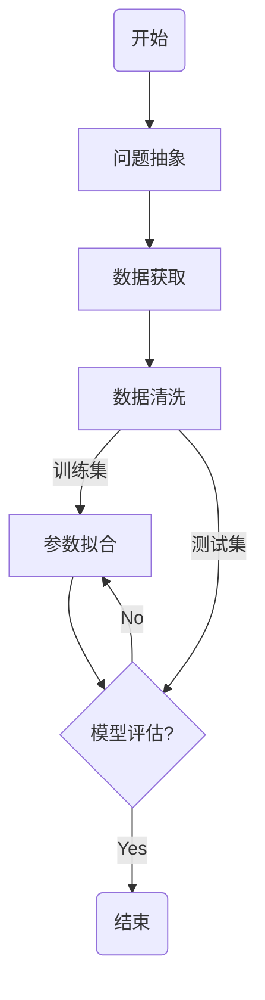

# Question1



# Question2

- 训练集
  - 用于训练模型的数据集
- 测试集
  - 用于测试模型效果的数据集
- 意义
  - 验证模型的可靠性
  - 多模型时选择最优模型的方式
- 欠拟合
  - 模型在训练集上表现不佳，模型能力过弱
- 过拟合
  - 模型过度捕捉训练集信息，导致其在测试集上表现不佳，模型能力过强（加入噪声等）

# Question3

## 基本概念

- 监督学习  
  - 根据某种已知的结果对模型进行评分和调整，预测变量和响应变量已知。
- 无监督学习
  - 模型从数据中总结预测函数f和信息，自行决定已知结果并调整参数。
- 回归
  - 响应变量为定量变量
- 分类
  - 响应变量为定性变量
- 混合类

- Summary
  
    | 学习类型 | 数据特点 | 任务目标 | 例子 |
    |---------|----------|----------|----------|
    | **监督学习** | 有标签数据 | 学习输入到输出的映射 | 线性回归、逻辑回归、决策树 |
    | **无监督学习** | 无标签数据 | 发现数据内在结构 | K-means、PCA、关联规则 | 
    | **分类任务** | 离散输出 | 预测类别标签 | 逻辑回归、SVM、随机森林 | 
    | **回归任务** | 连续输出 | 预测数值 | 线性回归、决策树回归 | 

# Question4

### 回归


- **均方误差（MSE）**：预测值与真实值之差的平方的平均值
   $$MSE = \frac{1}{n}\sum_{i=1}^{n}(y_i - \hat{y}_i)^2$$

- **均方根误差（RMSE）**：MSE的平方根，与目标变量单位相同
   $$RMSE = \sqrt{MSE}$$

- **平均绝对误差（MAE）**：预测值与真实值之差的绝对值的平均值
   $$MAE = \frac{1}{n}\sum_{i=1}^{n}|y_i - \hat{y}_i|$$

- **决定系数（R²）**：模型解释的方差比例，取值范围0-1，越接近1越好
   $$R^2 = 1 - \frac{\sum(y_i - \hat{y}_i)^2}{\sum(y_i - \bar{y})^2}$$

### 分类

- TP:真阳性
- TN:真阴性
- FP:假阳性
- FN:假阴性

- **准确度 Accuracy**：判断的正确率
   $$Accuracy = \frac{TP + TN}{TP + TN + FP + FN}$$

- **灵敏度sensitivity/召回率recall/命中率hit rate**：真实阳性被检测出的比例
   $$Sensitivity = \frac{TP}{TP + FN}$$

- **特异度specificity**：真实阴性被检测出的比例
   $$Specificity = \frac{TN}{TN + FP}$$

- **精度** : 判断为阳性的正确率
  $$Precision = \frac{TP}{TP + FP}$$

- **F1分数**：精度和召回度的调和平均数
   $$F1 = 2 \times \frac{Precision \times Recall}{Precision + Recall}$$

### 交叉验证

将整个数据集分割为多个训练块和测试块，评估每块数据的误差，然后取最终误差的平均值进行评估

- **k折交叉验证**：将数据分为k个子集，每次用k-1个子集训练，1个子集测试，重复k次
- **留一交叉验证**：k折交叉验证的特例，k等于样本数
- **分层k折交叉验证**：保持每个折中类别比例与原始数据集相同

# Question5

LASSO的目标函数：
$$\min_{\beta} \left\{\sum_{i=1}^{n}(y_i - \beta_0 - \sum_{j=1}^{p}\beta_jx_{ij})^2 + \lambda \sum_{j=1}^{p}|\beta_j| \right\}$$

即 $RSS+\lambda \sum_{j=1}^{p}|\beta_j|$

LASSO回归在普通的线性回归基础上加入L1范数惩罚项，使变量的系数可以为0

# Question6

# Question7

# Question8

# Question9

PCA用于对具有多个预测变量的数据进行降维，对原始预测变量进行线性组合得到正交基，称为主成分，按照方差大小降序排序。一般取前两个主成分。

# Code

## Q3&4

```r
# 汽车数据集
head(mtcars)

# 分测试集和训练集
split_size = 0.8
sample_size = floor(split_size * nrow(mtcars))
set.seed(123)
train_indices <- sample(seq_len(nrow(mtcars)), size = sample_size)

train <- mtcars[train_indices, ]
test <- mtcars[-train_indices, ]

model2 <- lm(mpg ~ disp, data=train)
# 测试集
new.data <- data.frame(disp = test$disp)
test$output <- predict(model2, new.data)
sqrt( sum( test$mpg - test$output)^2 / nrow(test))

# 回归模型评估指标
mse <- mean((test$mpg - test$output)^2)
rmse <- sqrt(mse)
mae <- mean(abs(test$mpg - test$output))
rsquared <- summary(model2)$r.squared

cat("均方误差 (MSE):", mse, "\n")
cat("均方根误差 (RMSE):", rmse, "\n")
cat("平均绝对误差 (MAE):", mae, "\n")
cat("决定系数 (R²):", rsquared, "\n")

# 线性回归交叉验证
library(caret)
set.seed(123)
train_control <- trainControl(method = "cv", number = 5)
model_cv <- train(mpg ~ disp, data = mtcars, method = "lm", trControl = train_control)
cat("\n交叉验证结果:\n")
print(model_cv$results)

#Logistics回归 
library(caTools)

Label.train = train[,9]
Data.train = train[,-9]

model = LogitBoost(Data.train, Label.train)
Data.test = test
Lab = predict(model, Data.test, type="raw")
data.frame(row.names(test), test$mpg, test$am, Lab)

# 分类模型评估指标
conf_matrix <- table(Predicted = Lab, Actual = test$am)
accuracy <- sum(diag(conf_matrix)) / sum(conf_matrix)
precision <- conf_matrix[2,2] / sum(conf_matrix[2,])
recall <- conf_matrix[2,2] / sum(conf_matrix[,2])
f1_score <- 2 * (precision * recall) / (precision + recall)

cat("\n分类模型评估指标:\n")
cat("混淆矩阵:\n")
print(conf_matrix)
cat("准确率:", accuracy, "\n")
cat("精确率:", precision, "\n")
cat("召回率:", recall, "\n")
cat("F1分数:", f1_score, "\n")

# 逻辑回归交叉验证
set.seed(123)
cv_folds <- createFolds(mtcars$am, k = 5)
cv_accuracy <- sapply(cv_folds, function(fold) {
  train_cv <- mtcars[-fold, ]
  test_cv <- mtcars[fold, ]
  model_cv <- LogitBoost(train_cv[,-9], train_cv[,9])
  pred_cv <- predict(model_cv, test_cv[,-9], type = "raw")
  mean(pred_cv == test_cv$am)
})
cat("\n逻辑回归交叉验证准确率:", mean(cv_accuracy), "\n")

#K-聚类分析  
plot(x = iris$Petal.Length, y = iris$Petal.Width,
     xlab = "Petal Length",ylab = "Petal Width")
iris_data <- data.frame(iris$Petal.Length, iris$Petal.Width)
iris.kmeans <- kmeans(iris_data, 2)
plot(x = iris$Petal.Length, y = iris$Petal.Width,pch = iris.kmeans$cluster,
     xlab = "Petal Length",ylab = "Petal Width")
points(iris.kmeans$centers, pch = 8, cex = 2)
iris.kmeans3 <- kmeans(iris_data, 3)
plot(x = iris$Petal.Length, y = iris$Petal.Width,pch = iris.kmeans3$cluster,
     xlab = "Petal Length",ylab = "Petal Width",main = "3kmeans")
points(iris.kmeans3$centers, pch = 8, cex = 2)
par(mfrow = c(1,2))
plot(x = iris$Petal.Length, y = iris$Petal.Width,pch = iris.kmeans3$cluster,
     xlab = "Petal Length",ylab = "Petal Width",main = "3kmeans")
plot(x = iris$Petal.Length, y = iris$Petal.Width,pch = as.integer(iris$Species),
     xlab = "Petal Length",ylab = "Petal Width",main = "truedata")
table(iris.kmeans3$cluster, iris$Species)

# 聚类评估指标
library(cluster)
silhouette_avg <- mean(silhouette(iris.kmeans3$cluster, dist(iris_data))[,3])
within_ss <- iris.kmeans3$tot.withinss
between_ss <- iris.kmeans3$betweenss

cat("\n聚类评估指标:\n")
cat("轮廓系数:", silhouette_avg, "\n")
cat("组内平方和:", within_ss, "\n")
cat("组间平方和:", between_ss, "\n")
cat("聚类与真实类别比较:\n")
print(table(iris.kmeans3$cluster, iris$Species))
```

## Q5

```r
if (!require(glmnet)) install.packages("glmnet");library(glmnet)
if (!require(ggplot2)) install.packages("ggplot2");library(ggplot2)
if (!require(dplyr)) install.packages("dplyr");library(dplyr)

data(mtcars)


x <- as.matrix(mtcars[, -1])  # 特征矩阵
y <- mtcars$mpg               # 响应变量

colnames(x)

set.seed(123)
lasso_model <- glmnet(x, y, alpha = 1)
print(lasso_model)

plot(lasso_model, xvar = "lambda", label = TRUE)
title("LASSO系数路径")


#交叉验证
set.seed(123)
cv_lasso <- cv.glmnet(x, y, alpha = 1)
plot(cv_lasso)
title("LASSO交叉验证")

# 查看最优lambda值
lambda_min <- cv_lasso$lambda.min
lambda_1se <- cv_lasso$lambda.1se

cat("最小MSE对应的lambda:", lambda_min, "\n")
cat("1个标准差规则对应的lambda:", lambda_1se, "\n")
coef_min <- coef(cv_lasso, s = "lambda.min")
cat("最小lambda对应的系数:\n")
print(coef_min)
coef_1se <- coef(cv_lasso, s = "lambda.1se")
cat("1se lambda对应的系数（更稀疏）:\n")
print(coef_1se)

coef_comparison <- data.frame(
  Feature = rownames(coef_min),
  Coef_min = as.numeric(coef_min),
  Coef_1se = as.numeric(coef_1se)
)
print(coef_comparison)

# 使用最优lambda进行预测
predictions <- predict(cv_lasso, newx = x, s = "lambda.min")
rmse <- sqrt(mean((y - predictions)^2))
cat("LASSO模型RMSE:", rmse, "\n")
r_squared <- 1 - sum((y - predictions)^2) / sum((y - mean(y))^2)
cat("LASSO模型R²:", r_squared, "\n")
plot_data <- data.frame(Actual = y, Predicted = as.numeric(predictions))
ggplot(plot_data, aes(x = Actual, y = Predicted)) +
  geom_point() +
  geom_abline(intercept = 0, slope = 1, color = "red") +
  ggtitle("LASSO回归: 预测值 vs 实际值") +
  theme_minimal()

# 拟合普通线性回归模型
lm_model <- lm(mpg ~ ., data = mtcars)
lm_predictions <- predict(lm_model)
lm_rmse <- sqrt(mean((y - lm_predictions)^2))
lm_r_squared <- summary(lm_model)$r.squared

# 比较结果
comparison <- data.frame(
  Model = c("普通线性回归", "LASSO回归"),
  RMSE = c(lm_rmse, rmse),
  R_squared = c(lm_r_squared, r_squared),
  Num_features = c(length(coef(lm_model)) - 1, 
                   sum(coef_min[-1] != 0))  # 非零特征数
)
print(comparison)

zero_coef_features <- coef_comparison$Feature[coef_comparison$Coef_1se == 0]
cat("被LASSO剔除的特征（lambda.1se）:\n")
print(zero_coef_features)

# 测试不同的lambda值
lambda_values <- c(0.001, 0.01, 0.1, 1, 10)

# 存储结果
results <- data.frame()

for (lambda in lambda_values) {
  # 使用指定lambda拟合模型
  model <- glmnet(x, y, alpha = 1, lambda = lambda)
  coefs <- as.numeric(coef(model))
  non_zero <- sum(coefs[-1] != 0)
  preds <- predict(model, newx = x)
  rmse_val <- sqrt(mean((y - preds)^2))
  results <- rbind(results, data.frame(
    Lambda = lambda,
    NonZero_Coefficients = non_zero,
    RMSE = rmse_val
  ))
}

print("不同lambda值的效果:")
print(results)

ggplot(results, aes(x = Lambda, y = NonZero_Coefficients)) +
  geom_line(size = 1) +
  geom_point(size = 2) +
  scale_x_log10() +
  labs(title = "LASSO: Lambda vs 非零特征数量",
       x = "Lambda (对数尺度)", y = "非零特征数量") +
  theme_minimal()
```