# 本文含有mermaid流程图和latex字体，博客在线查看效果更佳(^_^)

[链接地址](https://maywindsdu.cn/2025/11/26/Biology/Cell%20Biology/SignalTransduction/SignalTransduction/)

```
https://maywindsdu.cn/2025/11/26/Biology/Cell%20Biology/SignalTransduction/SignalTransduction/
```

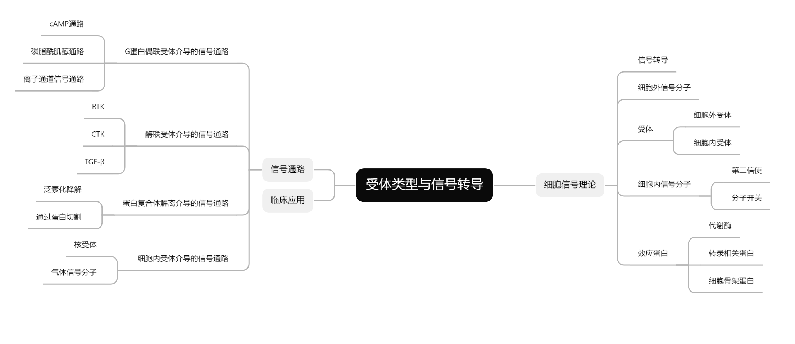

# 细胞信号理论


### 信号转导 signal transduction

- 细胞通过受体接受外界信号分子的刺激，转换为细胞内信号，启动细胞内的信号途径，引起细胞内一系列生理生化变化，从而影响细胞生物学功能的过程为信号转导。

- 信号转导一般由四部分合作完成：细胞外信号分子、受体、细胞内信号分子、效应蛋白

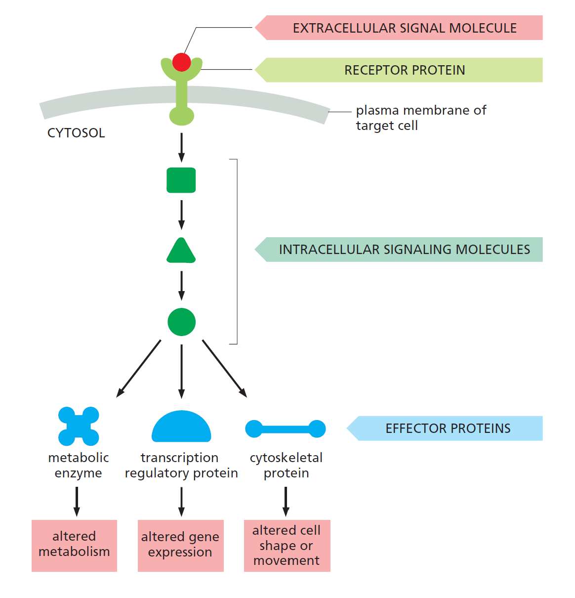

### 细胞外信号分子 extracellular signal molecule

- 又被称为第一信使，传递信息。分为膜受体和胞内受体。

### 受体 receptors

分为细胞表面受体和细胞内受体，其中细胞表面受体主要有3类

- G蛋白耦联受体 G-protein-coupled receptors
- 酶联受体 enzyme-coupled receptors
- 离子通道耦联受体 ion-channel-coupled receptors

受体通过细胞内信号分子来传递信号，这通常需要分子开关实现。

### 细胞内信号分子 intracellular signal molecule

- 第二信使 seconde messenger
  - 受体导致细胞内信号分子产生，进一步引发生化反应。通过浓度变化调节活性。
- 分子开关 molecular switch
  - 又称开关蛋白，通过激活与失活两种状态的转换控制下游靶蛋白活性。   
  - 可分为GTP结合蛋白与磷酸化去磷酸化转换蛋白

从信号的角度，细胞质内分子众多繁杂，是一个噪声较多的环境。因此细胞内信号分子具有特异性和鲁棒性的特点。

### 效应蛋白 effective proteins

- 代谢蛋白 metabolic enzyme
  - 调控代谢
- 转录相关蛋白 transcription regulatory protein
  - 调控基因表达
- 细胞骨架蛋白
  - 调控细胞的形态和移动

# G耦联蛋白受体介导的信号传导

## GPCRs和G蛋白结构

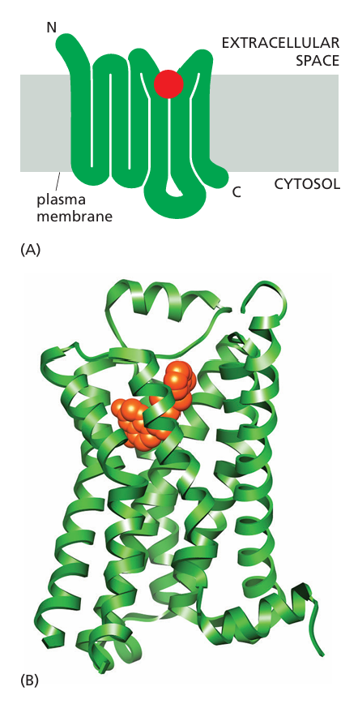

GPCR有7个穿膜的 $\alpha$ 螺旋结区，N段在细胞外侧，C端在胞质侧。螺旋5和6的胞内环状结构域可结合G蛋白。

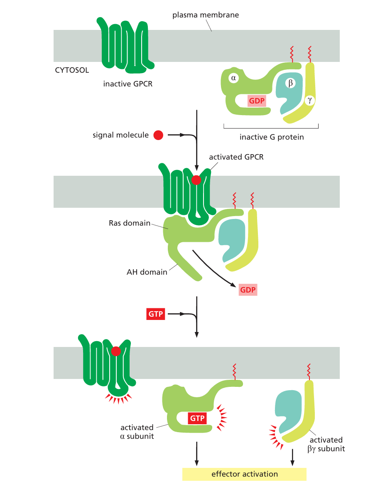

G蛋白是可溶性膜外周蛋白，

- $\alpha$ 亚基
  - 具有GTPase活性，未受刺激与其他两亚基结合，受刺激可分离成游离状态，结合效应蛋白并激活效应蛋白
  - $\text{G}\alpha-\text{GTP}$ 活化，水解成为 $\text{G}\alpha-\text{GDP}$ 失活，重新装配。
- $\beta \gamma$ 亚基 
  - 异二聚体形式存在

## cAMP信号通路

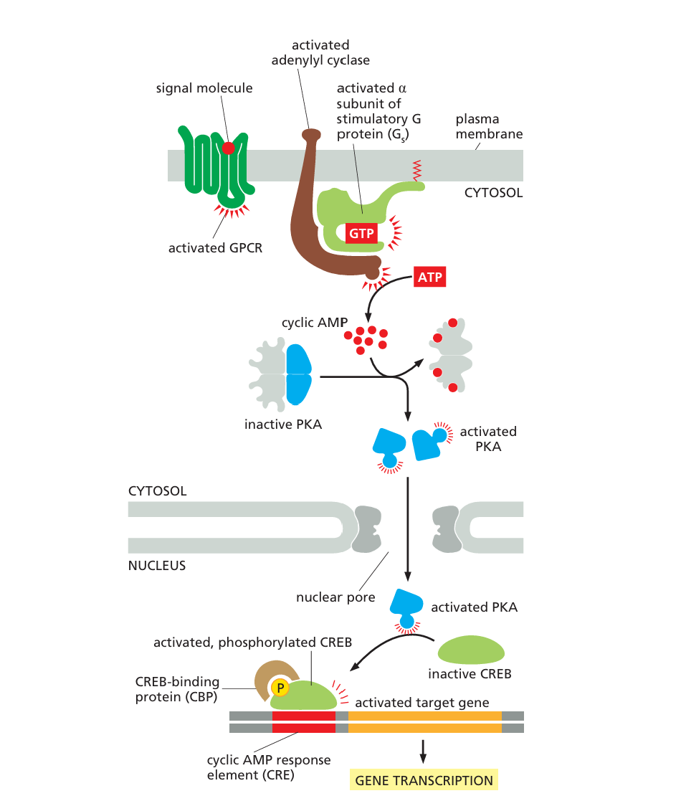

### cAMP

腺苷酸环化酶(AC)可催化ATP转化为cAMP

- 促进途径
  - Rs->Gs->AC
- 抑制途径
  - Ri->Gi-|AC
  - Gi-|Gs-$\alpha$

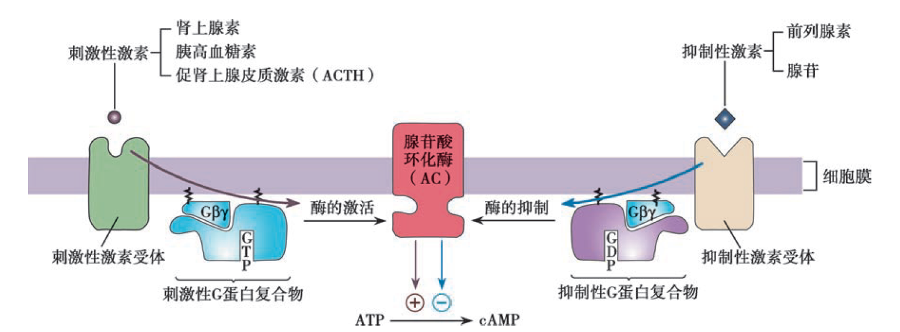

### PKA途径

cAMP可以与 **依赖于cAMP的蛋白激酶A（PKA）** 结合使其活化，进而调控效应蛋白。

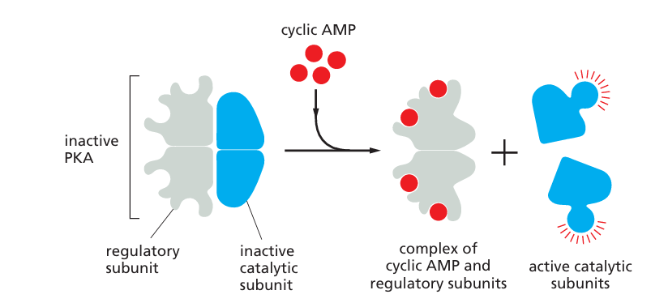

PKA为2个R亚基、2个C亚基的四聚体，C亚基释放后其激酶活性被激活，可催化信号通路下游蛋白Ser或Thr磷酸化激活效应蛋白。

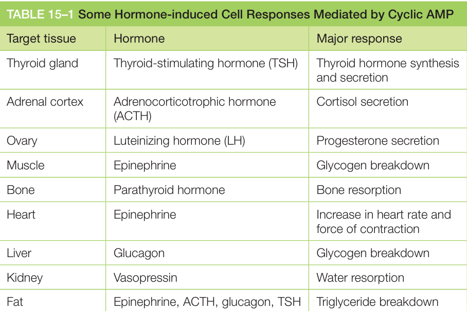

## 磷脂酰肌醇信号通路

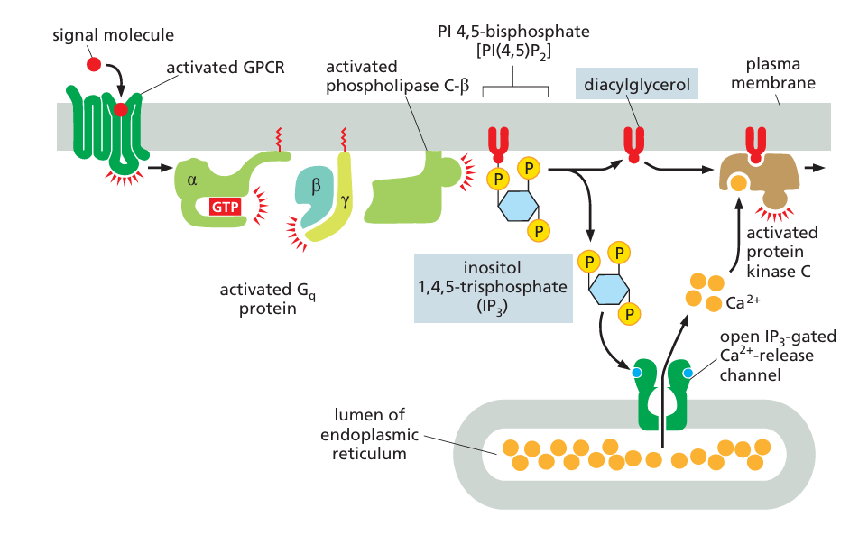

该通路为双第二信使（$\text{IP}_3$ 和 $\text{DAG}$），分别对应 $\text{IP}_3-\text{Ca}^{2+}$ 和 $\text{DAG}-\text{Ca}^{2+}$ 途径

### $\text{PIP}_2$

4-5-二磷酸磷脂酰肌醇($PIP_2$)可在磷脂酶C(PLC)的作用下疏解产生1,4,5-三磷酸肌醇 $\text{IP}_3$ 和 二酰甘油 $\text{DAG}$

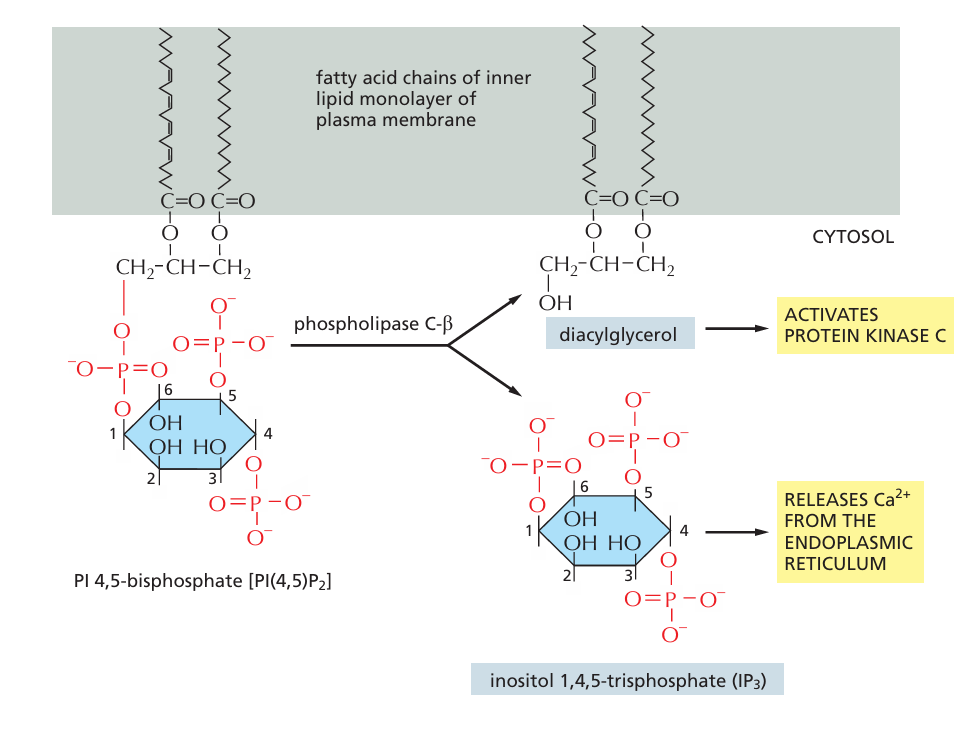

### $\text{IP}_3-\text{Ca}^{2+}$ 途径

$\text{IP}_3$ 与内质网 $Ca^{2+}$ 门控蛋白结合可瞬间提升胞内 $Ca^{2+}$ 浓度。
 
$\text{IP}_3$ 被转化为 $\text{IP}_2$ 或 $\text{IP}_4$ 使信号终止。 

### $\text{DAG}-\text{Ca}^{2+}$ 途径

钙离子与蛋白激酶C（PKC）结合转移到细胞膜内表面，由DAG活化。活化的PKC继续调控其他靶蛋白。

钙离子也会与钙调蛋白(CaM)结合调控。

## 离子通道信号通路

- 环核苷酸门控离子通道，存在于嗅觉、视觉细胞中。
- 心肌细胞的Ca2+通道调控。

# 酶联受体介导的信号通路

## RTKs受体

受体酪氨酸激酶（receptor tyrosine kinase，RTK）

- 无信号
  - 单体形式，失活
- 有信号
  - 结合信号分子，形成二聚体
  - 酪氨酸激酶活性激活，自体磷酸化
  - 形成SH2结合位点

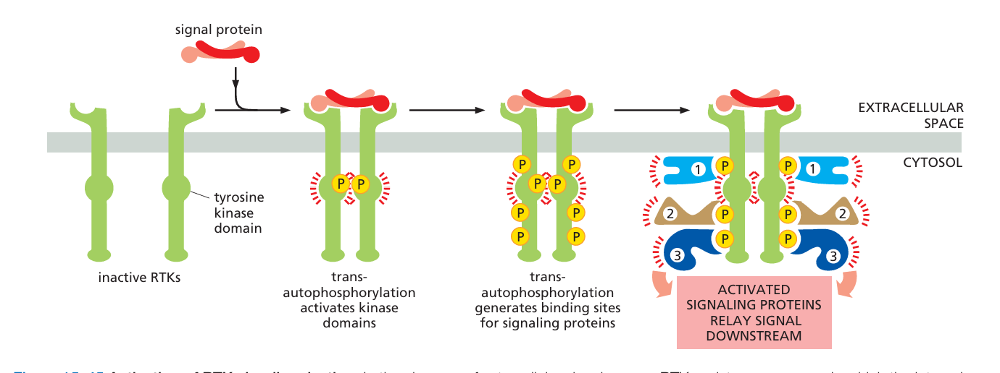

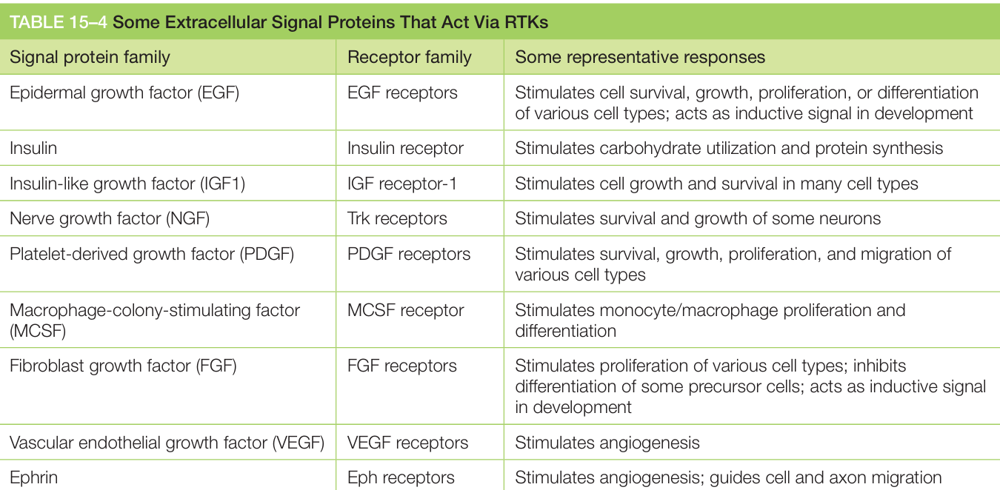

### Ras

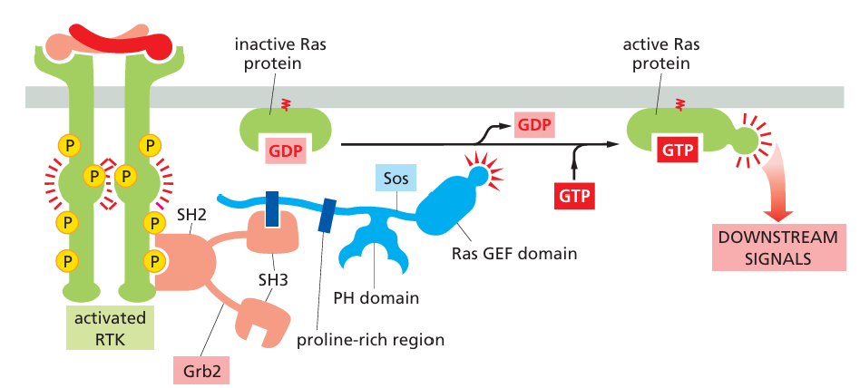

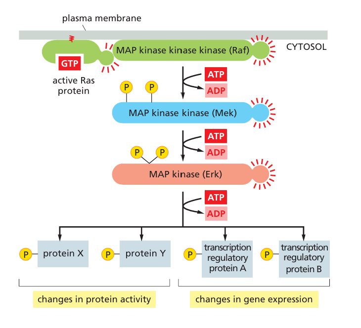

- 调控细胞增殖、分化与基因表达。
- 过程：
    1.  受体激活：配体结合诱导受体酪氨酸激酶二聚化及自磷酸化。
    2.  接头招募：接头蛋白通过其SH2结构域结合受体磷酸化酪氨酸位点。
    3.  Ras激活：Ras鸟嘌呤核苷酸交换因子被招募至质膜，催化Ras的GDP/GTP交换，使其激活。
    4.  激酶级联：活化的Ras启动MAPK磷酸化级联反应：Raf → MEK → ERK。
    5.  核内响应：活化的ERK易位至细胞核，磷酸化转录因子，调控靶基因表达。

### PI-3

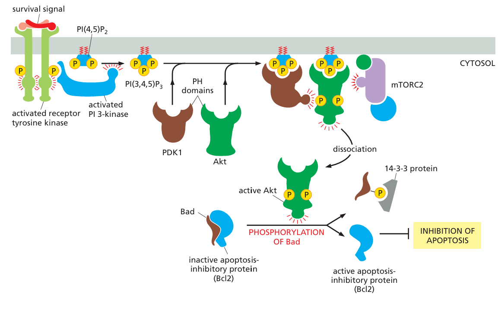

也存在磷酰脂肌醇途径，和GPCRs途径类似

-  功能：促进细胞存活、生长及代谢。
-  过程：
    1.  脂质磷酸化：活化的RTK招募并激活PI3K。
    2.  第二信使生成：PI3K催化磷脂酰肌醇第二信使PI(3,4,5)P3在质膜内层的生成。
    3.  信号蛋白募集：PI(3,4,5)P3通过其PH结构域募集Akt等信号蛋白至质膜。
    4.  Akt激活：Akt被PDK1等激酶磷酸化而完全激活。
    5.  下游效应：活化的Akt通过磷酸化多种靶蛋白，抑制凋亡、促进蛋白质合成等。

## Summary

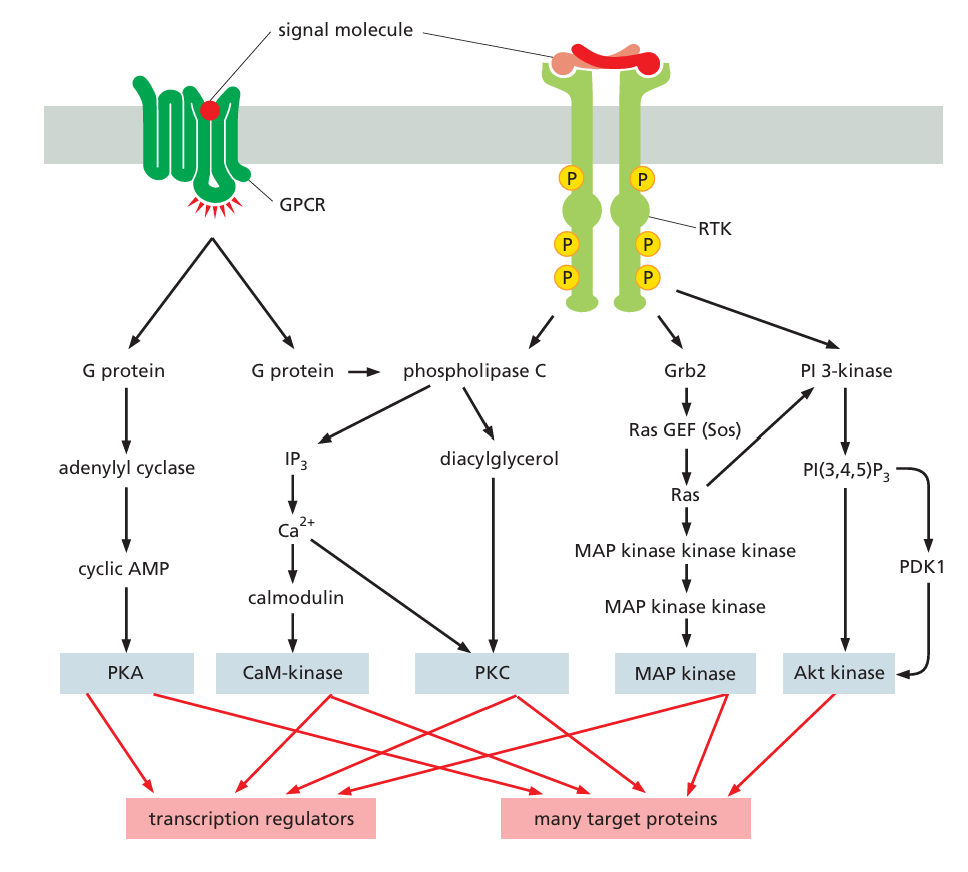

## CTK受体

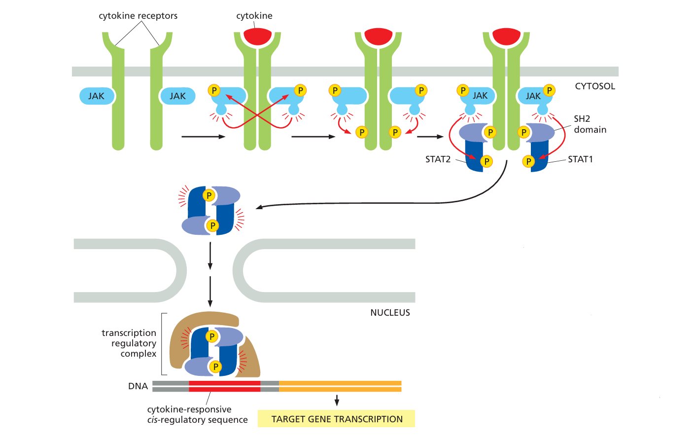

CTK结合受体，耦合JAK磷酸化—>含有SH2结构域的STAT蛋白被募集至磷酸化位点，并被JAK磷酸化->磷酸化的STAT形成同源或异源二聚体，转运至细胞核——>STAT二聚体直接结合特定DNA序列，作为转录因子调控靶基因表达。

## TGF-β受体

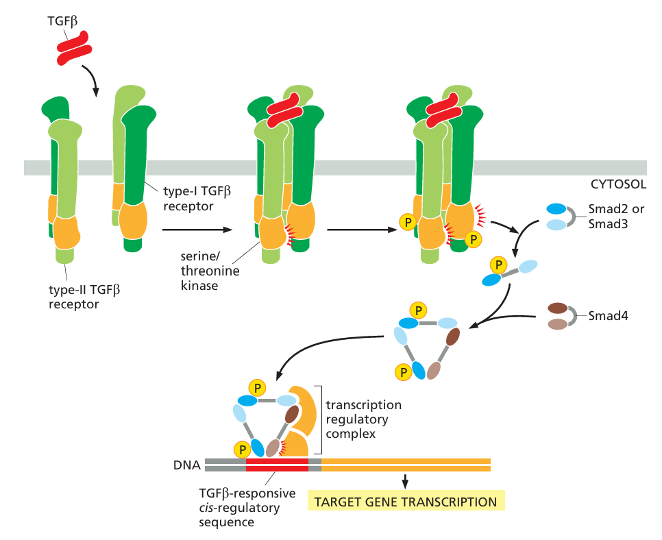

过程：
  1.  受体复合物组装：TGF-β配体与II型受体（组成性活性激酶）结合，随后招募并磷酸化I型受体。
  2.  R-Smad磷酸化：活化的I型受体激酶特异性磷酸化受体调节的Smad蛋白（R-Smad，如Smad2/3）。
  3.  复合物形成：磷酸化的R-Smad与通用Smad4形成异源三聚体复合物。
  4.  核内转运：该Smad复合物转运至细胞核。
  5.  基因表达调控：在核内，Smad复合物与其它转录因子协同作用，结合特定DNA序列，激活或抑制靶基因转录。

# 蛋白复合体解离介导的信号转导通路

## Notch信号通路

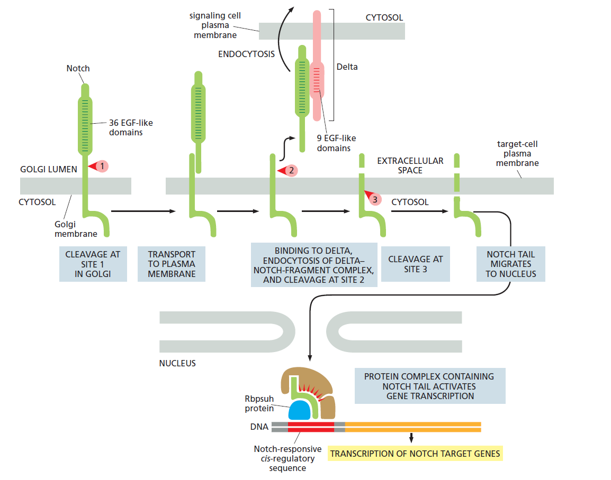

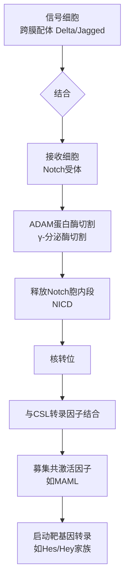
## Wnt信号通路

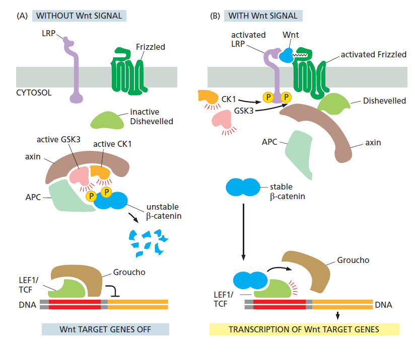
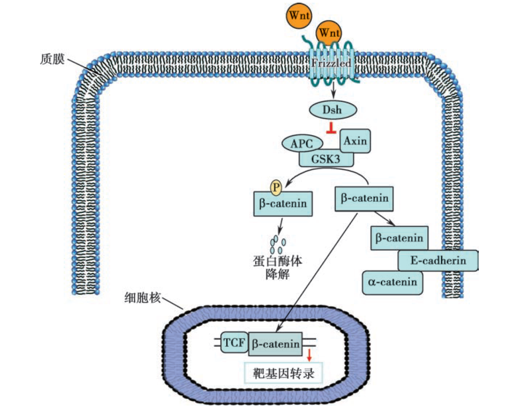

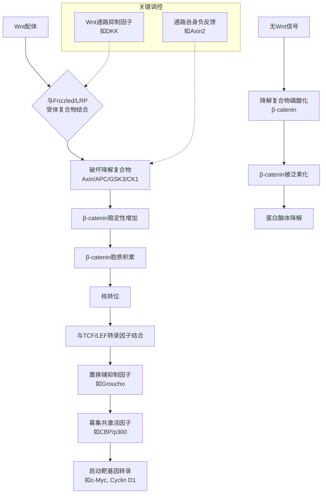

## Hedgehog信号通路

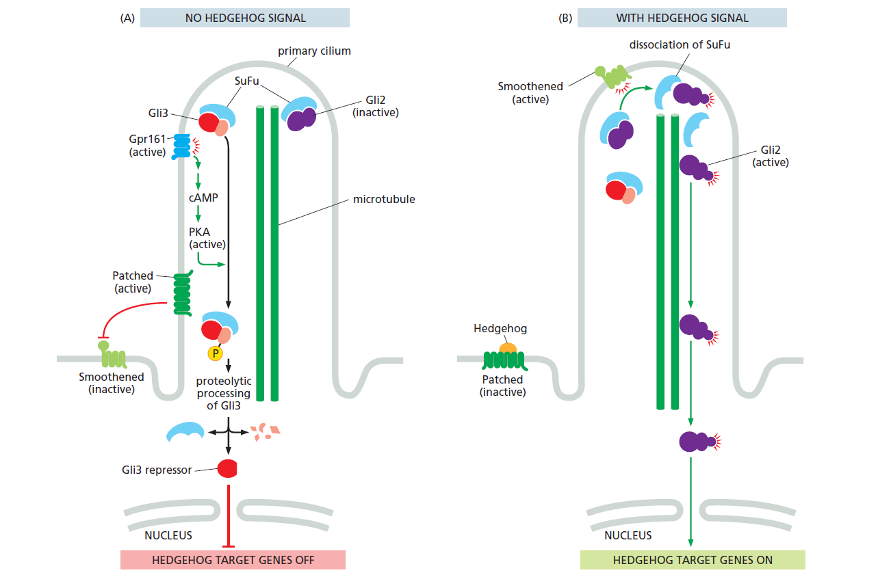

Hedgehog信号起始于Patched细胞表面受体，激活Gli转录调节因子。

没有该信号时

- Patched-|Smoothened

- SuFu-| Gli

- Gpr161-> Gli3 -| Hedgehog相应基因

信号存在时

- Hedgehog结合Patched->patched移出纤毛->smoothened抑制解除，进入纤毛->
Gpr161从纤毛中移除，Gli3减少。
- smoothened解除Gli的抑制->触发Gli2蛋白的修饰->被激活的Gli2蛋白运出纤毛，进入细胞质，扩散到细胞核->众多Hedgehog靶基因的表达上调。

Hedgehog信号能够促进细胞增殖,为原癌基因。

## NF-κB信号通路

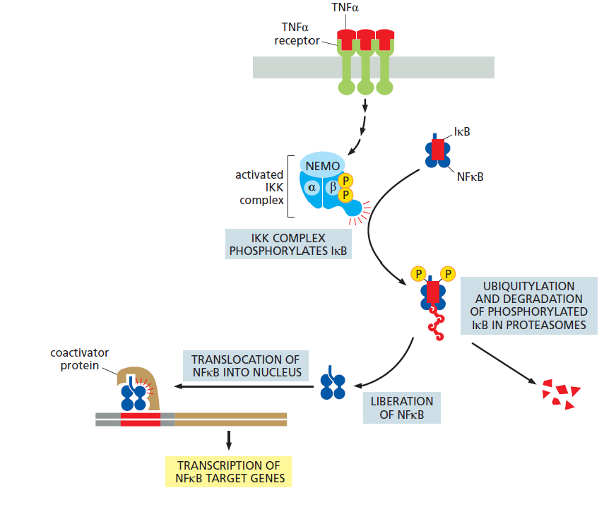
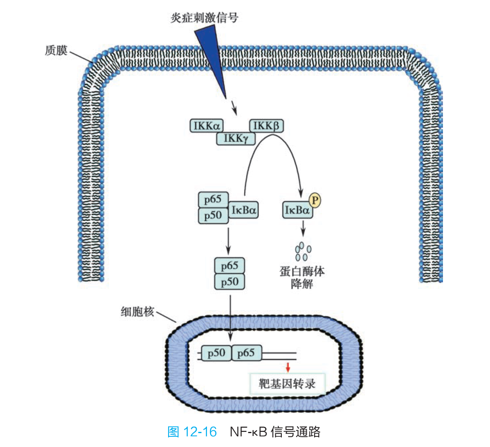

- 介导细胞对促炎细胞因子、病原体相关分子模式及其它应激信号的反应。
- 核心调控靶基因涉及免疫应答、炎症反应、细胞增殖与抗凋亡。

1.  **静息状态**
    - NF-κB二聚体与抑制蛋白IκB结合，被锚定于细胞质中，处于非活性状态。

2.  **通路激活**
    - 上游信号激活IKK复合物，该复合物由催化亚基IKKα、IKKβ及调节亚基NEMO组成。
    - IKKβ磷酸化IκB，导致其被E3泛素连接酶识别并发生泛素化修饰。
    - 泛素化的IκB被蛋白酶体降解，NF-κB因而被释放。

3.  **核内基因调控**
    - 暴露核定位信号的NF-κB迅速转运入核。
    - 与靶基因启动子或增强子上的特定κB序列结合。
    - 招募转录共激活因子，启动特定基因的转录。


- **正调控**：促炎信号通过激活IKK复合物，触发IκB降解，是通路的核心激活机制。
- **负反馈**：NF-κB可诱导IκBα的重新合成，新合成的IκBα入核可将NF-κB置换并带回胞质，终止信号。
- **药理抑制**：糖皮质激素通过抑制NF-κB的转录活性发挥抗炎作用。

# 细胞内受体介导的信号通路

### 核受体
  - **定义**：位于细胞核或细胞质中的配体依赖的转录调控因子。类固醇激素、甲状腺激素、维甲酸等亲脂性信号分子可穿透质膜与其结合。
  - **激活机制**：配体与受体结合后，受体构象改变，与抑制性蛋白解离，暴露出DNA结合位点，形成活化的激素-受体复合物。
  - **基因调控**：活化的复合物进入细胞核，通过结合靶基因启动子区的激素应答元件，或通过影响其他转录因子，直接或间接调控基因转录。
  - **意义**：调控细胞生长、分化等核心生命活动，其功能异常与糖尿病、脂肪肝等多种疾病密切相关。

### 气体信号分子
  - **特点**：由一氧化氮合酶催化L-精氨酸生成，无专门储存机制，生成后依靠自由扩散作用于邻近靶细胞。
  - **作用机制**：NO扩散至平滑肌细胞，与鸟苷酸环化酶结合并激活其活性，催化生成cGMP，进而激活蛋白激酶G，引发一系列生化反应（如血管平滑肌松弛）。
  - **意义**：在血管舒张、神经传递（如参与学习记忆的长时程增强效应）中起关键作用。硝酸甘油等药物的作用机制即通过生成NO实现。

# 临床应用

- 信号分子异常：例如胰岛素生成减少或拮抗导致血糖升高，引发糖尿病。
- 受体异常：
  - 遗传性：如家族性高胆固醇血症因LDL受体缺陷。
  - 自身免疫性：如重症肌无力因乙酰胆碱受体抗体。
  - 继发性：如肥胖性糖尿病因胰岛素受体减少和敏感性下降。
- G蛋白异常：
  - 霍乱毒素激活Gs蛋白，导致cAMP持续增加和严重腹泻。
  - 百日咳毒素抑制Gi蛋白，导致cAMP增加和严重咳嗽。
- 蛋白激酶异常：与肿瘤发生相关，如佛波酯激活PKC促进增殖；免疫细胞激酶异常导致免疫疾病。
- 信号转导与药物研发：研究信号通路中蛋白质相互作用提供药物靶点，如开发蛋白激酶抑制剂。

# 参考文献

ALBERTS B. Molecular biology of the cell [M]. 7th ed. New York: Garland Science, 2022.

陈誉华等. 医学细胞生物学[M]. 7版. 北京: 人民卫生出版社, 2024. 