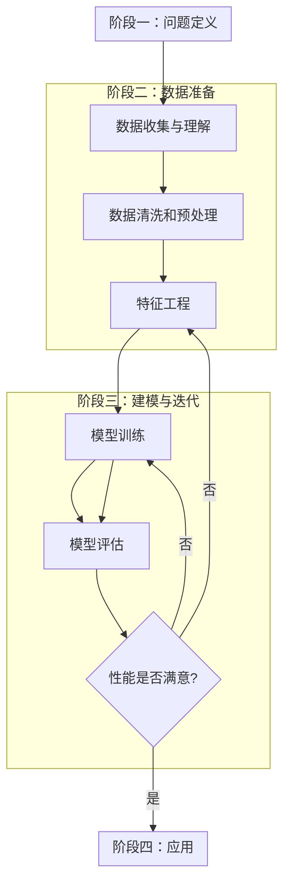
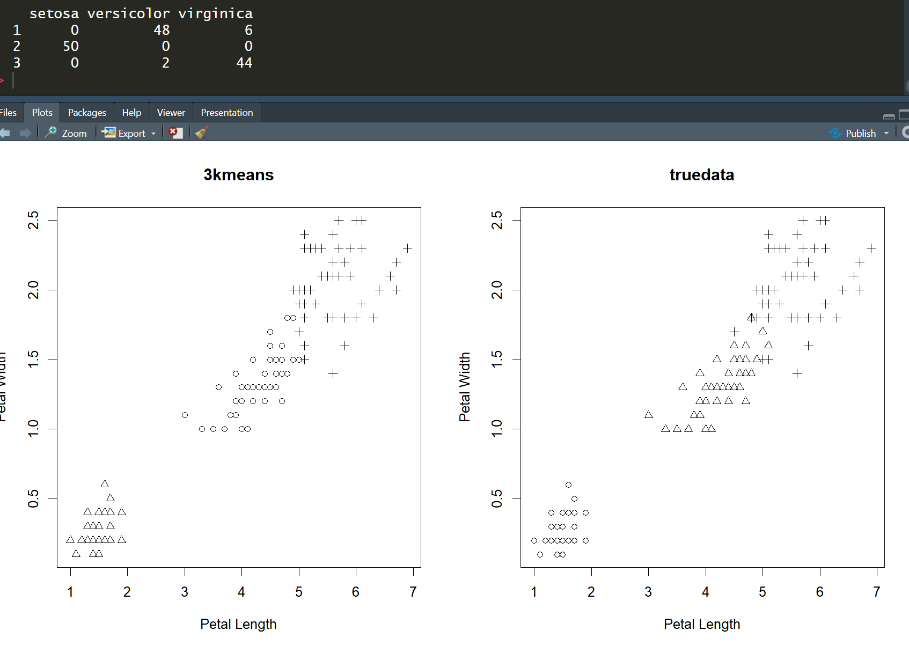

## Question1



## Question2

- 训练集
  - 用于训练模型的数据集
- 测试集
  - 用于测试模型效果的数据集
- 意义
  - 验证模型的可靠性
  - 多模型时选择最优模型的方式
- 欠拟合
  - 模型在训练集上表现不佳，模型能力过弱
- 过拟合
  - 模型过度捕捉训练集信息，导致其在测试集上表现不佳，模型能力过强（加入噪声等）

## Question3

- 监督学习  
  - 根据某种已知的结果对模型进行评分和调整，预测变量和响应变量已知。
- 无监督学习
  - 模型从数据中总结预测函数f和信息，自行决定已知结果并调整参数。
- 回归
  - 响应变量为定量变量
- 分类
  - 响应变量为定性变量
- 混合类

- Summary
  
    | 学习类型 | 数据特点 | 任务目标 | 例子 |
    |---------|----------|----------|----------|
    | **监督学习** | 有标签数据 | 学习输入到输出的映射 | 线性回归、逻辑回归、决策树 |
    | **无监督学习** | 无标签数据 | 发现数据内在结构 | K-means、PCA、关联规则 | 
    | **分类任务** | 离散输出 | 预测类别标签 | 逻辑回归、SVM、随机森林 | 
    | **回归任务** | 连续输出 | 预测数值 | 线性回归、决策树回归 | 

## Question4

### 回归


- **均方误差（MSE）**：预测值与真实值之差的平方的平均值
   $$MSE = \frac{1}{n}\sum_{i=1}^{n}(y_i - \hat{y}_i)^2$$

- **均方根误差（RMSE）**：MSE的平方根，与目标变量单位相同
   $$RMSE = \sqrt{MSE}$$

- **平均绝对误差（MAE）**：预测值与真实值之差的绝对值的平均值
   $$MAE = \frac{1}{n}\sum_{i=1}^{n}|y_i - \hat{y}_i|$$

- **决定系数（R²）**：模型解释的方差比例，取值范围0-1，越接近1越好
   $$R^2 = 1 - \frac{\sum(y_i - \hat{y}_i)^2}{\sum(y_i - \bar{y})^2}$$

### 分类

- TP:真阳性
- TN:真阴性
- FP:假阳性
- FN:假阴性

- **准确度 Accuracy**：判断的正确率
   $$Accuracy = \frac{TP + TN}{TP + TN + FP + FN}$$

- **灵敏度sensitivity/召回率recall/命中率hit rate**：真实阳性被检测出的比例
   $$Sensitivity = \frac{TP}{TP + FN}$$

- **特异度specificity**：真实阴性被检测出的比例
   $$Specificity = \frac{TN}{TN + FP}$$

- **精度** : 判断为阳性的正确率
  $$Precision = \frac{TP}{TP + FP}$$

- **F1分数**：精度和召回度的调和平均数
   $$F1 = 2 \times \frac{Precision \times Recall}{Precision + Recall}$$

### 交叉验证

将整个数据集分割为多个训练块和测试块，评估每块数据的误差，然后取最终误差的平均值进行评估

- **k折交叉验证**：将数据分为k个子集，每次用k-1个子集训练，1个子集测试，重复k次
- **留一交叉验证**：k折交叉验证的特例，k等于样本数
- **分层k折交叉验证**：保持每个折中类别比例与原始数据集相同

```r
# 汽车数据集
head(mtcars)

# 分测试集和训练集
split_size = 0.8
sample_size = floor(split_size * nrow(mtcars))
set.seed(123)
train_indices <- sample(seq_len(nrow(mtcars)), size = sample_size)

train <- mtcars[train_indices, ]
test <- mtcars[-train_indices, ]

model2 <- lm(mpg ~ disp, data=train)
# 测试集
new.data <- data.frame(disp = test$disp)
test$output <- predict(model2, new.data)
sqrt( sum( test$mpg - test$output)^2 / nrow(test))

# 回归模型评估指标
mse <- mean((test$mpg - test$output)^2)
rmse <- sqrt(mse)
mae <- mean(abs(test$mpg - test$output))
rsquared <- summary(model2)$r.squared

cat("均方误差 (MSE):", mse, "\n")
cat("均方根误差 (RMSE):", rmse, "\n")
cat("平均绝对误差 (MAE):", mae, "\n")
cat("决定系数 (R²):", rsquared, "\n")

# 线性回归交叉验证
library(caret)
set.seed(123)
train_control <- trainControl(method = "cv", number = 5)
model_cv <- train(mpg ~ disp, data = mtcars, method = "lm", trControl = train_control)
cat("\n交叉验证结果:\n")
print(model_cv$results)

#Logistics回归 
library(caTools)

Label.train = train[,9]
Data.train = train[,-9]

model = LogitBoost(Data.train, Label.train)
Data.test = test
Lab = predict(model, Data.test, type="raw")
data.frame(row.names(test), test$mpg, test$am, Lab)

# 分类模型评估指标
accuracy <- sum(diag(conf_matrix)) / sum(conf_matrix)
precision <- conf_matrix[2,2] / sum(conf_matrix[2,])
recall <- conf_matrix[2,2] / sum(conf_matrix[,2])
f1_score <- 2 * (precision * recall) / (precision + recall)

cat("准确率:", accuracy, "\n")
cat("精确率:", precision, "\n")
cat("召回率:", recall, "\n")
cat("F1分数:", f1_score, "\n")

# 逻辑回归交叉验证
set.seed(123)
cv_folds <- createFolds(mtcars$am, k = 5)
cv_accuracy <- sapply(cv_folds, function(fold) {
  train_cv <- mtcars[-fold, ]
  test_cv <- mtcars[fold, ]
  model_cv <- LogitBoost(train_cv[,-9], train_cv[,9])
  pred_cv <- predict(model_cv, test_cv[,-9], type = "raw")
  mean(pred_cv == test_cv$am)
})
cat("\n逻辑回归交叉验证准确率:", mean(cv_accuracy), "\n")

#K-聚类分析  
plot(x = iris$Petal.Length, y = iris$Petal.Width,
     xlab = "Petal Length",ylab = "Petal Width")
iris_data <- data.frame(iris$Petal.Length, iris$Petal.Width)
iris.kmeans <- kmeans(iris_data, 2)
plot(x = iris$Petal.Length, y = iris$Petal.Width,pch = iris.kmeans$cluster,
     xlab = "Petal Length",ylab = "Petal Width")
points(iris.kmeans$centers, pch = 8, cex = 2)
iris.kmeans3 <- kmeans(iris_data, 3)
plot(x = iris$Petal.Length, y = iris$Petal.Width,pch = iris.kmeans3$cluster,
     xlab = "Petal Length",ylab = "Petal Width",main = "3kmeans")
points(iris.kmeans3$centers, pch = 8, cex = 2)
par(mfrow = c(1,2))
plot(x = iris$Petal.Length, y = iris$Petal.Width,pch = iris.kmeans3$cluster,
     xlab = "Petal Length",ylab = "Petal Width",main = "3kmeans")
plot(x = iris$Petal.Length, y = iris$Petal.Width,pch = as.integer(iris$Species),
     xlab = "Petal Length",ylab = "Petal Width",main = "truedata")
table(iris.kmeans3$cluster, iris$Species)

# 聚类评估指标
library(cluster)
silhouette_avg <- mean(silhouette(iris.kmeans3$cluster, dist(iris_data))[,3])
within_ss <- iris.kmeans3$tot.withinss
between_ss <- iris.kmeans3$betweenss

cat("\n聚类评估指标:\n")
cat("轮廓系数:", silhouette_avg, "\n")
cat("组内平方和:", within_ss, "\n")
cat("组间平方和:", between_ss, "\n")
cat("聚类与真实类别比较:\n")
print(table(iris.kmeans3$cluster, iris$Species))
```



## Question5

LASSO的目标函数：
$$\min_{\beta} \left\{\sum_{i=1}^{n}(y_i - \beta_0 - \sum_{j=1}^{p}\beta_jx_{ij})^2 + \lambda \sum_{j=1}^{p}|\beta_j| \right\}$$

即 $RSS+\lambda \sum_{j=1}^{p}|\beta_j|$


LASSO回归在普通的线性回归基础上加入L1范数惩罚项，使变量的系数可以为0

## Question6

随机森林是一种集成学习方法，通过构建多棵决策树并将它们的预测结果组合起来，以提高预测准确性和模型的鲁棒性。

决策树过程

- 从原始数据集中通过自助采样法抽取多个样本子集

- 为每个样本子集构建一棵决策树

- 在每棵树的每个节点分裂时，随机选择特征子集进行考虑

- 将所有树的预测结果进行组合（分类任务使用投票，回归任务使用平均）

## Question7

支持向量机SVM是一种监督学习算法，可用于分类和回归任务。SVM的核心思想是找到一个最优的超平面，将不同类别的数据点分开，同时最大化边界（间隔）。

## Question8

由大量相互连接的节点（神经元）组成。输入向量经过神经网络得到输出向量。

### 神经网络的基本组成

- 神经元
  - 神经网络的基本处理单元

- 层
  - 输入层
    - 接收原始特征
  - 隐藏层
    - 进行特征变换和模式学习
  - 输出层
    - 产生最终预测

- 权重和偏置  
  - 连接神经元之间的参数

- 激活函数
  - 非线性函数模拟神经元的激活过程，使网络能够学习复杂模式

## Question9

PCA用于对具有多个预测变量的数据进行降维，对原始预测变量进行线性组合得到正交基，称为主成分，按照方差大小降序排序。一般取前两个主成分。

## Summary

| 评估维度 | 随机森林 | 神经网络 | 支持向量机 |
| :--- | :--- | :--- | :--- |
| **模型解释性** | **中** | **低** | **中-高** (线性核时) |
| | • **优点**： 能提供特征重要性排序，一定程度上理解数据。<br>• **缺点**： 整体仍是“黑箱”，难以解释具体预测路径。 | • **缺点**： 典型的“黑箱”模型，内部层级复杂，决策逻辑极难追溯和解释。 | • **优点**： 对于线性核，权重向量清晰明了。<br>• **缺点**： 使用非线性核后，可解释性变差。 |
| **训练数据需求** | **低-中** | **高** | **中** |
| | 在小到中型数据集上也能表现良好，不易过拟合。 | 通常是**数据饥渴型**，需要海量数据才能发挥潜力，避免过拟合。 | 在小样本数据集上表现优异，但数据量极大时训练会非常慢。 |
| **训练效率/速度** | **高** | **低** | **中** (数据量大时变为**低**) |
| | 树可以并行训练，速度快。 | 结构复杂，参数多，需要大量计算（尤其是深度学习），训练慢。 | 训练复杂度约为 \(O(n^2)\) 到 \(O(n^3)\)，数据量激增时速度急剧下降。 |
| **预测速度** | **中** | **高** (前向传播) | **中** (取决于支持向量数量) |
| | 需要遍历所有树进行投票，树越多越慢。 | 训练好后，预测只是前向传播，非常快。 | 预测速度取决于支持向量的数量，数量越多越慢。 |
| **处理高维特征能力** | **高** | **高** | **高** |
| | 天然适合处理高维特征，甚至可以进行特征选择。 | 能够很好地处理和挖掘高维特征中的复杂模式。 | 核函数使其在处理高维甚至无限维空间时游刃有余。 |
| **处理非线性问题** | **高** (天然非线性) | **高** (核心能力) | **高** (依赖核技巧) |
| | 通过决策树的分裂天然处理非线性关系。 | 通过激活函数和隐藏层拟合任意复杂非线性函数。 | 必须使用合适的**核函数**（如RBF）才能处理非线性问题。 |
| **调参难度** | **低** | **高** | **中** |
| | 参数较少，且对参数不敏感，默认参数往往就有不错效果。 | 超参数极多（层数、节点数、学习率等），调参复杂，需要大量经验。 | 对核函数、惩罚参数C、核参数等比较敏感，需要仔细调优。 |
| **抗过拟合能力** | **高** | **低** (需正则化) | **中-高** (依赖C参数) |
| | 通过Bagging和随机特征选择来降低方差，抗过拟合能力强。 | 模型容量大，极易过拟合，必须使用Dropout、正则化等技术。 | 通过最大化间隔和惩罚参数C来控制过拟合，调好C时抗过拟合能力强。 |

---