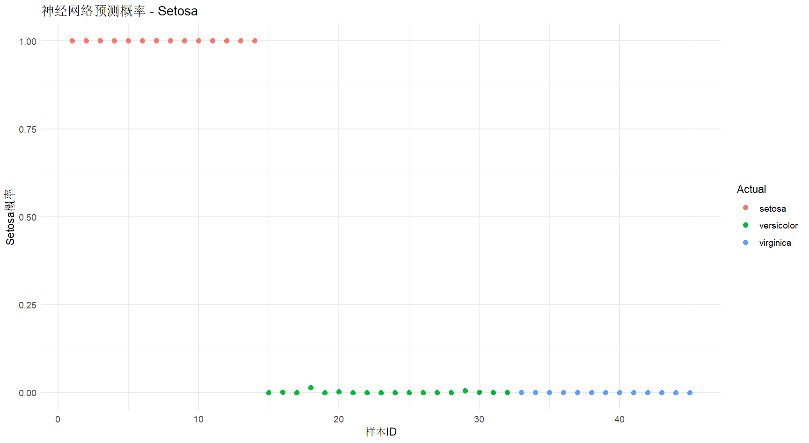
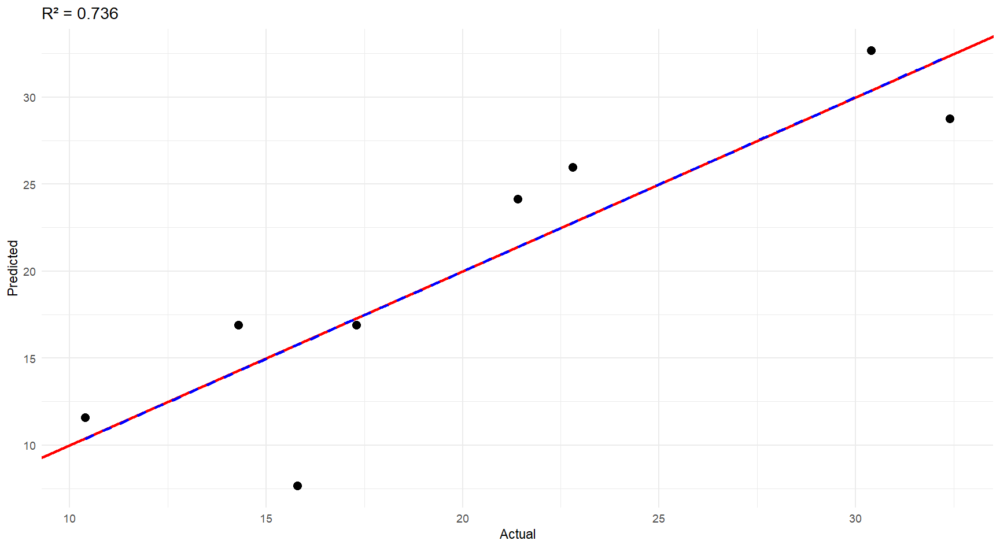

人工神经网络是受生物神经网络启发的计算模型，由大量相互连接的节点（神经元）组成。

## 基本组成
- **神经元**：神经网络的基本处理单元
- **层**：
  - **输入层**：接收原始特征
  - **隐藏层**：进行特征变换和模式学习
  - **输出层**：产生最终预测
- **权重和偏置**：连接神经元之间的参数
- **激活函数**：引入非线性，使网络能够学习复杂模式

**常用激活函数：**
- **Sigmoid**：$f(x) = \frac{1}{1 + e^{-x}}$
- **Tanh**：$f(x) = \tanh(x)$
- **ReLU**：$f(x) = \max(0, x)$

**神经网络训练过程：**
1. **前向传播**：输入数据通过网络计算输出
2. **计算损失**：比较预测输出与真实标签
3. **反向传播**：计算梯度并更新权重
4. **迭代优化**：重复上述过程直到收敛

## 算法过程

### 前向传播

给定一个 $L$ 层的神经网络，前向传播过程如下：

$$
\begin{aligned}
\mathbf{z}^{(l)} &= \mathbf{W}^{(l)}\mathbf{a}^{(l-1)} + \mathbf{b}^{(l)} \\
\mathbf{a}^{(l)} &= f^{(l)}(\mathbf{z}^{(l)})
\end{aligned}
$$

其中：
- $\mathbf{z}^{(l)}$ 是第 $l$ 层的加权输入
- $\mathbf{a}^{(l)}$ 是第 $l$ 层的激活输出
- $\mathbf{W}^{(l)}$ 和 $\mathbf{b}^{(l)}$ 是第 $l$ 层的权重和偏置
- $f^{(l)}$ 是第 $l$ 层的激活函数

### 损失函数

对于训练样本 $(\mathbf{x}, \mathbf{y})$，损失函数为：

$$ J(\mathbf{W}, \mathbf{b}; \mathbf{x}, \mathbf{y}) = \frac{1}{2} \|\mathbf{a}^{(L)} - \mathbf{y}\|^2 $$

## 反向传播推导

### 误差项定义

定义第 $l$ 层的误差项为：

$$ \delta^{(l)} = \frac{\partial J}{\partial \mathbf{z}^{(l)}} $$

### 输出层误差

输出层的误差计算为：

$$
\begin{aligned}
\delta^{(L)} &= \frac{\partial J}{\partial \mathbf{z}^{(L)}} \\
&= \frac{\partial J}{\partial \mathbf{a}^{(L)}} \cdot \frac{\partial \mathbf{a}^{(L)}}{\partial \mathbf{z}^{(L)}} \\
&= (\mathbf{a}^{(L)} - \mathbf{y})^{\text{T}} f'^{(L)}(\mathbf{z}^{(L)})
\end{aligned}
$$


### 隐藏层误差

对于 $l = L-1, L-2, \ldots, 2$：

$$
\begin{aligned}
\delta^{(l)} &= \frac{\partial J}{\partial \mathbf{z}^{(l)}} \\
&= \frac{\partial J}{\partial \mathbf{z}^{(l+1)}} \cdot \frac{\partial \mathbf{z}^{(l+1)}}{\partial \mathbf{a}^{(l)}} \cdot \frac{\partial \mathbf{a}^{(l)}}{\partial \mathbf{z}^{(l)}} \\
&= \left[(\mathbf{W}^{(l+1)})^T \delta^{(l+1)}\right] \odot f'^{(l)}(\mathbf{z}^{(l)})
\end{aligned}
$$

### 参数梯度

最终的目的是调整参数

$$
\begin{aligned}
\frac{\partial J}{\partial \mathbf{W}^{(l)}} &= \delta^{(l)} (\mathbf{a}^{(l-1)})^T \\
\frac{\partial J}{\partial \mathbf{b}^{(l)}} &= \delta^{(l)}
\end{aligned}
$$


---

## R
```r
# 加载包
if (!require("nnet")) install.packages("nnet")
if (!require("ggplot2")) install.packages("ggplot2")
if (!require("caret")) install.packages("caret")
if (!require("dplyr")) install.packages("dplyr")
if (!require("neuralnet")) install.packages("neuralnet")

library(nnet)
library(ggplot2)
library(caret)
library(dplyr)
library(neuranet)

# 神经网络对数据尺度敏感，需要进行标准化
normalize <- function(x) {
  return((x - min(x)) / (max(x) - min(x)))
}

# 使用iris数据集进行分类任务
data(iris)

# 创建训练集和测试集
set.seed(123)
train_index <- sample(1:nrow(iris), 0.7 * nrow(iris))
train_data <- iris[train_index, ]
test_data <- iris[-train_index, ]

# 标准化特征（神经网络对输入尺度敏感）
train_scaled <- as.data.frame(lapply(train_data[, -5], normalize))
test_scaled <- as.data.frame(lapply(test_data[, -5], normalize))

# 添加类别标签
train_scaled$Species <- train_data$Species
test_scaled$Species <- test_data$Species

set.seed(123)
nnet_model <- nnet(Species ~ ., 
                   data = train_scaled,
                   size = 8,          # 隐藏层神经元数量
                   maxit = 1000,      # 最大迭代次数
                   decay = 5e-4,      # 权重衰减（正则化）
                   trace = FALSE)     # 不显示训练过程

# 查看模型摘要
summary(nnet_model)

# 预测
nnet_predictions <- predict(nnet_model, test_scaled, type = "class")

# 评估
nnet_accuracy <- mean(nnet_predictions == test_data$Species)
cat("nnet模型准确率:", round(nnet_accuracy, 3), "\n")

# 可视化预测概率
prob_matrix <- predict(nnet_model, test_scaled, type = "raw")
colnames(prob_matrix) <- levels(iris$Species)

# 创建概率数据框
prob_df <- as.data.frame(prob_matrix)
prob_df$Actual <- test_data$Species
prob_df$Predicted <- nnet_predictions
prob_df$ID <- 1:nrow(prob_df)

# 绘制概率分布
ggplot(prob_df, aes(x = ID, y = setosa, color = Actual)) +
  geom_point(size = 2) +
  labs(title = "神经网络预测概率 - Setosa",
       x = "样本ID", y = "Setosa概率") +
  theme_minimal()
```

```r
# 使用mtcars回归
data(mtcars)

normalize_with_params <- function(x, min_val, max_val) {
  return((x - min_val) / (max_val - min_val))
}

set.seed(123)

# 数据分割
train_index <- createDataPartition(mtcars$mpg, p = 0.7, list = FALSE)
train_data <- mtcars[train_index, ]
test_data <- mtcars[-train_index, ]

# 特征选择
high_cor_features <- c("mpg", "wt", "cyl", "disp", "hp", "drat", "qsec")
train_data <- train_data[, high_cor_features]
test_data <- test_data[, high_cor_features]

# 标准化
train_min <- sapply(train_data, min)
train_max <- sapply(train_data, max)

train_scaled <- as.data.frame(
  mapply(normalize_with_params, train_data, train_min, train_max)
)
test_scaled <- as.data.frame(
  mapply(normalize_with_params, test_data, train_min, train_max)
)
names(train_scaled) <- names(train_data)
names(test_scaled) <- names(test_data)

# 模型
nn_model <- neuralnet(
  mpg ~ .,
  data = train_scaled,
  hidden = c(10, 6, 3),
  linear.output = TRUE,
  act.fct = "tanh",
  threshold = 0.02,
  stepmax = 2e6,
  rep = 5,
  algorithm = "rprop+"
)

# 预测和评估
nn_pred <- compute(nn_model, test_scaled[, -1])$net.result
nn_mpg <- nn_pred * (train_max["mpg"] - train_min["mpg"]) + train_min["mpg"]

nn_rmse <- sqrt(mean((test_data$mpg - nn_mpg)^2))
nn_r2 <- 1 - sum((test_data$mpg - nn_mpg)^2) / sum((test_data$mpg - mean(test_data$mpg))^2)

cat("RMSE:", round(nn_rmse, 3), "\n")
cat("R²:", round(nn_r2, 3), "\n")

# 性能分析
performance_analysis <- data.frame(
  Actual = test_data$mpg,
  Predicted = nn_mpg,
  Residual = test_data$mpg - nn_mpg
)

ggplot(performance_analysis, aes(x = Actual, y = Predicted)) +
  geom_point(size = 3) +
  geom_abline(intercept = 0, slope = 1, color = "red", size = 1) +
  geom_smooth(method = "lm", se = FALSE, color = "blue", linetype = "dashed") +
  ggtitle(paste("R² =", round(nn_r2, 3))) +
  theme_minimal()
```

