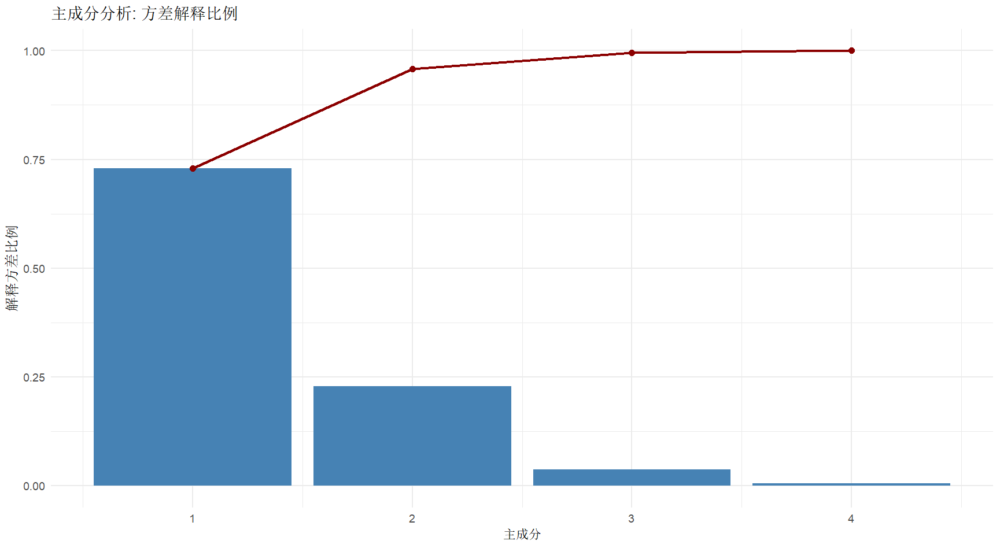
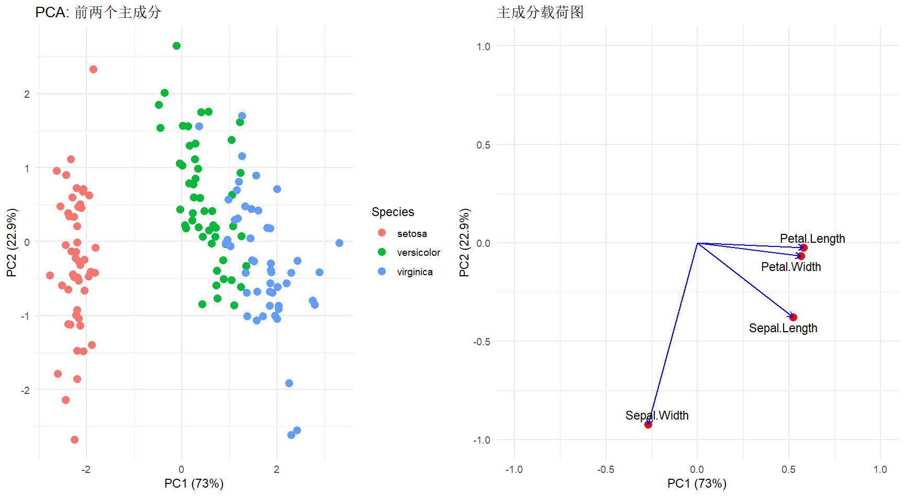
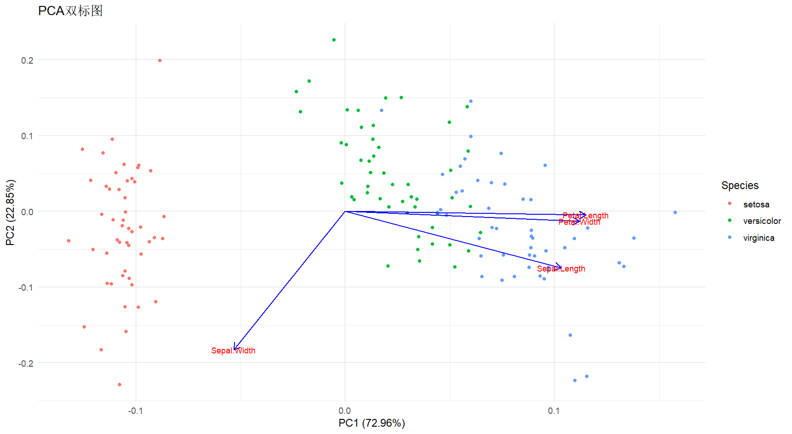

# Principal Component Analysis 


# Code

## R

### PCA分析

```r
library(ggplot2)
if(!require("ggfortify"))install.packages("ggfortify");library(ggfortify)
library(ggrepel)

# 使用iris数据集
data(iris)
iris_features <- iris[, 1:4]

# 执行PCA分析
pca_result <- prcomp(iris_features, scale. = TRUE)
summary(pca_result)

# 计算每个主成分解释的方差比例
variance_explained <- pca_result$sdev^2 / sum(pca_result$sdev^2)

# 创建方差解释图
pca_variance <- data.frame(
  PC = 1:length(variance_explained),
  Variance = variance_explained,
  Cumulative = cumsum(variance_explained)
)

ggplot(pca_variance, aes(x = PC, y = Variance)) +
  geom_bar(stat = "identity", fill = "steelblue") +
  geom_line(aes(y = Cumulative), color = "darkred", size = 1) +
  geom_point(aes(y = Cumulative), color = "darkred", size = 2) +
  scale_x_continuous(breaks = 1:4) +
  labs(title = "主成分分析: 方差解释比例",
       x = "主成分", y = "解释方差比例") +
  theme_minimal()
```



前两个主成分足够解释，将其可视化并探查其载荷成分

```r
# 获取主成分得分
pca_scores <- as.data.frame(pca_result$x)
pca_scores$Species <- iris$Species

# 绘制前两个主成分的散点图
p1 <- ggplot(pca_scores, aes(x = PC1, y = PC2, color = Species)) +
  geom_point(size = 3) +
  labs(title = "PCA: 前两个主成分",
       x = paste0("PC1 (", round(variance_explained[1]*100, 1), "%)"),
       y = paste0("PC2 (", round(variance_explained[2]*100, 1), "%)")) +
  theme_minimal()
# 分析主成分载荷
loadings <- pca_result$rotation

# 绘制载荷图
loadings_df <- as.data.frame(loadings)
loadings_df$Feature = rownames(loadings)

p2 <- ggplot(loadings_df, aes(x = PC1, y = PC2, label = Feature)) +
  geom_point(size = 3, color = "red") +
  geom_segment(aes(x = 0, y = 0, xend = PC1, yend = PC2), 
               arrow = arrow(length = unit(0.2, "cm")), 
               color = "blue") +
  geom_text_repel() +
  labs(title = "主成分载荷图",
       x = paste0("PC1 (", round(variance_explained[1]*100, 1), "%)"),
       y = paste0("PC2 (", round(variance_explained[2]*100, 1), "%)")) +
  theme_minimal() +
  xlim(-1, 1) + ylim(-1, 1)
grid.arrange(p1, p2, ncol = 2)
```





### 聚类分析

```r
# 使用前两个主成分进行K-means聚类
set.seed(123)
kmeans_result <- kmeans(pca_scores[, 1:2], centers = 3, nstart = 20)
pca_scores$Cluster <- as.factor(kmeans_result$cluster)

# 评估聚类效果
table(Cluster = pca_scores$Cluster, Species = pca_scores$Species)

# 使用前k个主成分重建数据
k <- 2  
compressed_data <- pca_result$x[, 1:k]
reconstructed_data <- compressed_data %*% t(pca_result$rotation[, 1:k])

# 计算重建误差
reconstruction_error <- mean((iris_features - reconstructed_data)^2)
print(paste("重建误差:", reconstruction_error))

library(plotly)
plot_ly(pca_scores, x = ~PC1, y = ~PC2, z = ~PC3, color = ~Species) %>%
  add_markers(size = 5) %>%
  layout(
    title = "3D PCA Plot",
    scene = list(
      xaxis = list(title = paste0("PC1 (", round(variance_explained[1]*100, 1), "%)")),
      yaxis = list(title = paste0("PC2 (", round(variance_explained[2]*100, 1), "%)")),
      zaxis = list(title = paste0("PC3 (", round(variance_explained[3]*100, 1), "%)"))
    )
  )
```