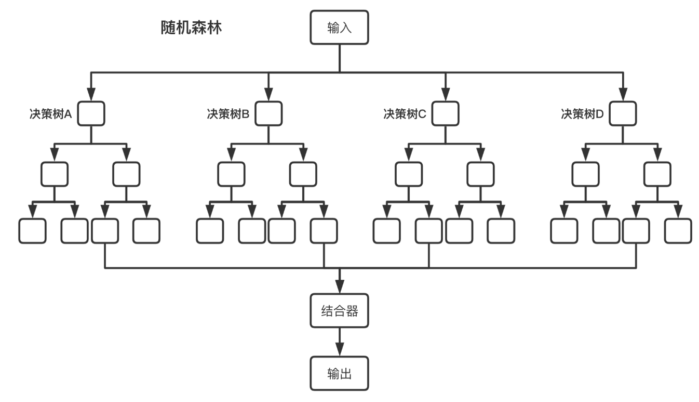
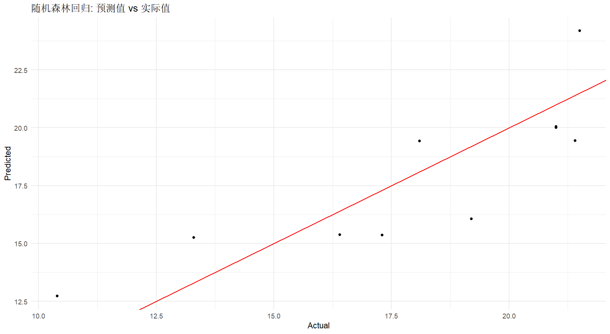

随机森林是一种集成学习方法，通过构建多棵决策树并将它们的预测结果组合起来，以提高预测准确性和模型的鲁棒性。


## 基本概念

- **集成学习**：通过组合多个弱学习器（决策树）来创建一个强学习器
- **Bagging**：通过自助采样法为每棵树创建不同的训练子集
- **特征随机性**：在每棵树的每个节点分裂时，只考虑特征的一个随机子集
- **降低方差**：通过平均多棵树的预测结果来减少过拟合

## 执行流程

1. 从原始数据集中通过自助采样法抽取多个样本子集
2. 为每个样本子集构建一棵决策树
3. 在每棵树的每个节点分裂时，随机选择特征子集进行考虑
4. 将所有树的预测结果进行组合（分类任务使用投票，回归任务使用平均）

## 特点

- 对过拟合有很强的抵抗能力(但也可能造成过拟合)
- 能够处理高维特征空间
- 不需要特征缩放
- 能够估计特征重要性
- 对缺失值有一定的鲁棒性



---

## Code

```r
if (!require(randomForest)) install.packages("randomForest")
if (!require(ggplot2)) install.packages("ggplot2")
if (!require(caret)) install.packages("caret")

library(randomForest)
library(ggplot2)
library(caret)

data(iris)
set.seed(123)
train_index <- sample(1:nrow(iris), 0.7 * nrow(iris))
train_data <- iris[train_index, ]
test_data <- iris[-train_index, ]

# 训练随机森林分类模型
rf_class <- randomForest(Species ~ ., 
                        data = train_data,
                        ntree = 500,        # 树的数量
                        mtry = 2,           # 每棵树考虑的特征数
                        importance = TRUE,  # 计算特征重要性
                        proximity = TRUE)   # 计算样本相似度

# 预测测试集
predictions <- predict(rf_class, test_data)
# 评估模型
confusion_matrix <- table(Predicted = predictions, Actual = test_data$Species)
print("混淆矩阵:")
print(confusion_matrix)

accuracy <- sum(diag(confusion_matrix)) / sum(confusion_matrix)
cat("准确率:", round(accuracy, 3), "\n")

# 使用mtcars进行回归
data(mtcars)
set.seed(123)
train_index <- sample(1:nrow(mtcars), 0.7 * nrow(mtcars))
train_data <- mtcars[train_index, ]
test_data <- mtcars[-train_index, ]
rf_reg <- randomForest(mpg ~ ., 
                      data = train_data,
                      ntree = 500,
                      mtry = 3,
                      importance = TRUE)

predictions <- predict(rf_reg, test_data)

rmse <- sqrt(mean((test_data$mpg - predictions)^2))
r_squared <- 1 - sum((test_data$mpg - predictions)^2) / sum((test_data$mpg - mean(test_data$mpg))^2)

cat("RMSE:", round(rmse, 3), "\n")
cat("R²:", round(r_squared, 3), "\n")

# 可视化预测效果
plot_data <- data.frame(Actual = test_data$mpg, Predicted = predictions)
ggplot(plot_data, aes(x = Actual, y = Predicted)) +
  geom_point() +
  geom_abline(intercept = 0, slope = 1, color = "red") +
  ggtitle("随机森林回归: 预测值 vs 实际值") +
  theme_minimal()
```

```
               setosa versicolor virginica
  setosa         14          0         0
  versicolor      0         17         0
  virginica       0          1        13
```

$$R^2 = 0.694$$

