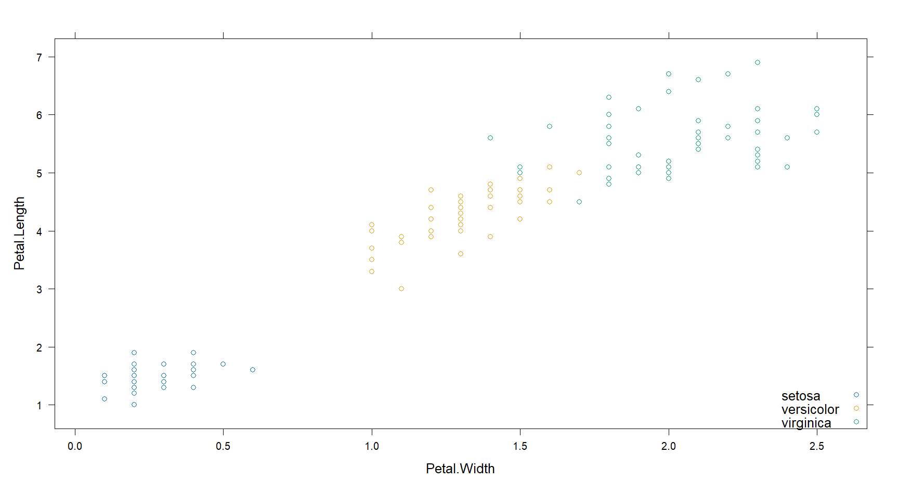
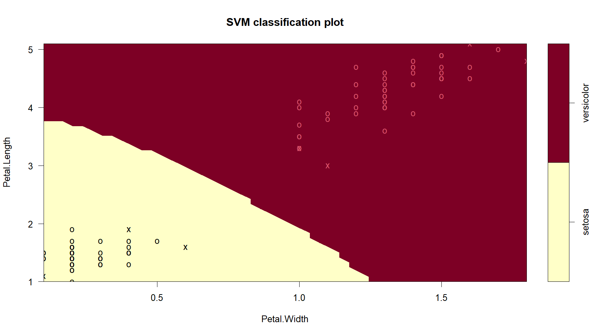
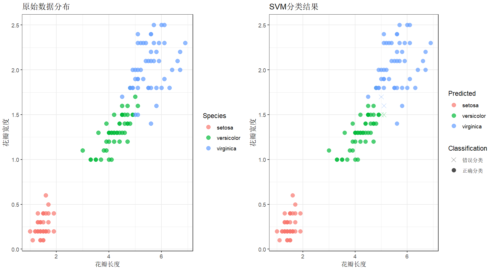

# 线性可分的SVM

## 基本概念

### 超平面 hyperplane

数据集可以被超平面分隔为二类，超平面为

$$\mathbf{w}^{\text{T}}\mathbf{x}+b=0$$

记作 $h(\mathbf{x}) = 0$


基于此超平面的分类模型可以用 $f(\mathbf{x}) = \mathbf{w}^{\text{T}}\mathbf{x}+b$表示,若 $f(\mathbf{x}) > 0$，则分类标签 $y = 1$。若 $f(\mathbf{x}) = 0$ 此点恰好在超平面上。 $f(\mathbf{x}) < 0$ 时 $y = -1$。

### 函数距离 funcitional margin

考虑与 $h(\mathbf{x}) = 0$ 相平行的超平面可以写作 $f(\mathbf{x}) = c$，可以用 $c$ 衡量一个点到超平面的距离，于是有

$$|f(\mathbf{x}) - h(\mathbf{x})| = |f(\mathbf{x})| = yf(\mathbf{x})$$

函数距离 $\hat{\gamma}$ 的定义为

$$\hat{\gamma} = yf(\mathbf{x}) = y(\mathbf{w}^{\text{T}}\mathbf{x}+b)$$

### 几何距离 geometrical margin

如果 $\mathbf{w}$ 和 $b$ 等比例放大，函数距离会发生改变，但超平面实际上并未移动。

因此考虑几何距离，即点到平面距离公式

$$\gamma = \frac{|f(\mathbf{x})|}{||\mathbf{w}||} = \frac{yf(\mathbf{x})}{||\mathbf{w}||}$$

### 最大间隔超平面/最优间隔超平面

距离训练观测点最远的平面

### 支持向量

与最大间隔超平面相离最近的点，经过其且与最大间隔超平面平行的超平面称为支持超平面。

## 最大间隔分类器

当超平面离数据点间隔越大，分类结果越可靠。

由此定义最大间隔分类器的目标函数为 

$$\argmax_{\mathbf{w},b}\left\{\frac{1}{||\mathbf{w}||}\min_n[y_n(\mathbf{w}^{\text{T}}\mathbf{x_n}+b)]\right\}$$

通过线性变换，$f(\mathbf{x})$ 的取值并不固定，因此可以钦定支持超平面和最大间隔超平面的距离为1，于是目标函数化简为

$$\max_{\mathbf{w},b}\frac{1}{||\mathbf{w}||}$$

约束条件

$$\text{s.t.}\quad y_i(\mathbf{w^{\text{T}}}+b) \geq 1,\quad i = 1,2,\dots,n$$

等价于

$$
\begin{aligned}
&\min \frac{1}{2}||\mathbf{w}||^2 \\
\text{s.t.}\quad &y_i(\mathbf{w^{\text{T}}}\mathbf{x}_i+b),\forall i
\end{aligned}
$$

采用平方是为了求导方便,构造广义拉格朗日函数

$$L(\mathbf{w},b,\mathbf{\alpha}) = \frac{1}{2}||\mathbf{w}||^2 + \sum_{i=1}^n \alpha_i \left[1 - y_i(\mathbf{w^{\text{T}}}\mathbf{x}_i+b)\right]$$

改写为

$$\min_{\mathbf{w},b} \max_{\alpha_i \geq 0} L (\mathbf{w},b,\mathbf{\alpha}) = p^*$$

### 对偶问题的求解

原始问题

$$\min_{\mathbf{w},b} \max_{\alpha_i \geq 0} L(\mathbf{w},b,\mathbf{\alpha}) = p^*$$

满足 $\text{KKT}$ 条件：

又因为为凸函数，因此原问题满足强对偶性。考虑其对偶问题

$$\max_{\alpha_i \geq 0} \min_{\mathbf{w},b} L(\mathbf{w},b,\mathbf{\alpha}) = d^*$$

令偏导数为0即

$$
\begin{aligned}
\frac{\partial L}{\partial \mathbf{w}} &= 0 \\ \\
\frac{\partial L}{\partial b} &= 0
\end{aligned}
$$

可得

$$
\begin{aligned}
\sum_{i=1}^n \alpha_i y_i \mathbf{x}_i &= \mathbf{w} \\
\sum_{i=1}^n \alpha_i y_i &= 0
\end{aligned}
$$

代入广义拉格朗日函数得

$$
\begin{aligned}
L(\mathbf{w},b,\mathbf{\alpha}) &= \frac{1}{2}||\mathbf{w}||^2 + \sum_{i=1}^n \alpha_i \left[1 - y_i(\mathbf{w^{\text{T}}}\mathbf{x}_i+b)\right] \\
&= \frac{1}{2}\mathbf{w}^{\text{T}}\mathbf{w} + \sum_{i=1}^n (\alpha_i + b \alpha_i y_i - \mathbf{w^{\text{T}}}\alpha_i y_i\mathbf{x}_i) \\
&= \sum_{i=0}^{n}\alpha_i - \frac{1}{2}\mathbf{w^{\text{T}}}\sum_{i=1}^n\alpha_i y_i\mathbf{x}_i \\
&= \sum_{i=0}^{n}\alpha_i - \frac{1}{2}\sum_{i=1}^n\alpha_i y_i\mathbf{x}_i^{\text{T}} \sum_{j=1}^n\alpha_j y_j\mathbf{x}_j \\
&= \sum_{i=0}^{n}\alpha_i - \frac{1}{2}\sum_{i=1}^n\sum_{j=1}^n \alpha_i \alpha_j y_iy_j(\mathbf{x}_i^{\text{T}})\mathbf{x}_j \\
&= \sum_{i=0}^{n}\alpha_i - \frac{1}{2}\sum_{i=1}^n\sum_{j=1}^n \alpha_i \alpha_j y_iy_j\langle\mathbf{x}_i, \mathbf{x_j}\rangle \\
\end{aligned}
$$

于是有

$$
\begin{aligned}
&\max_{\alpha_i \geq 0} \min_{\mathbf{w},b} L(\mathbf{w},b,\mathbf{\alpha}) = \max_{\alpha}\left\{\sum_{i=0}^{n}\alpha_i - \frac{1}{2}\sum_{i=1}^n\sum_{j=1}^n \alpha_i \alpha_j y_iy_j\langle\mathbf{x}_i, \mathbf{x}_j\rangle
\right\} \\
&\text{s.t.} \quad \sum_{i=1}^n \alpha_i y_i = 0,\alpha_i \geq 0, \forall i 
\end{aligned}
$$

等价于以下问题

$$
\begin{aligned}
&\min_{\alpha}\left\{\frac{1}{2}\sum_{i=1}^n\sum_{j=1}^n \alpha_i \alpha_j y_iy_j\langle\mathbf{x}_i, \mathbf{x}_j\rangle-\sum_{i=0}^{n}\alpha_i 
\right\} \\
&\text{s.t.} \quad \sum_{i=1}^n \alpha_i y_i = 0,\alpha_i \geq 0, \forall i 
\end{aligned}
$$

这是一个等式约束优化问题，使用拉格朗日乘数法便可得到最优值 $\mathbf{\alpha^*}$,从而得到$\mathbf{\mathbf{w}^*}$ 和 $b^*$ 。在此条件下构造的模型称为硬间隔模型。

此时我们的分类函数为

$$f(\mathbf{x}) = \mathbf{w}^{\text{T}}\mathbf{x} + b = \sum_{i=1}^{n}\alpha_i^*y_i \langle\mathbf{x}_i, \mathbf{x}\rangle + b$$

因此，预测新点 $\mathbf{x}$ 只需要计算它与训练集点的内积即可。此外，我们只需计算支持向量，因为非支持向量的系数为0.

# 松弛因子与软间隔

由于噪声，部分数据点会偏离正常位置较远，称为异常点（Outlier）。对异常点 $x_i$ 引入松弛因子 $\xi_i$ ，允许异常点在超平面间有偏移。为了防止 $\xi_i$ 任意大，也需对其进行约束。问题即为

$$
\begin{aligned}
&\min \frac{1}{2} ||\mathbf{w}||^2 + C\sum_{i=1}^n \xi_i \\
\text{s.t.}\quad &y_i(\mathbf{w}^{\text{T}}\mathbf{x}_i+b） \geq 1 - \xi_i,\quad \xi_i \geq 0,\quad \forall i 
\end{aligned}
$$

注意 $\mathbf{\xi}$ 为变量而 $C$ 是已经决定好的常量

于是构造广义拉格朗日函数

$$L(\mathbf{w},b,\mathbf{\alpha},\mathbf{\xi},\mathbf{\mu}) = \frac{1}{2}||\mathbf{w}||^2 + C\sum_{i=1}^n \xi_i + \sum_{i=1}^n \alpha_i \left[1 - y_i(\mathbf{w^{\text{T}}}\mathbf{x}_i+b)-\xi_i\right] - \sum_{i=1}^n \mu_i\xi_i$$

改写为

$$\min_{\mathbf{w},b,\mathbf{\xi}} \max_{\alpha_i,\mu_i\geq 0} L(\mathbf{w},b,\mathbf{\alpha},\mathbf{\xi},\mathbf{\mu}) = p^*$$

其对偶问题

$$\max_{\alpha_i,\mu_i\geq 0} \min_{\mathbf{w},b,\mathbf{\xi}}  L(\mathbf{w},b,\mathbf{\alpha},\mathbf{\xi},\mathbf{\mu}) = d^*$$

令偏导数为0即

$$
\begin{aligned}
\frac{\partial L}{\partial \mathbf{w}} &= 0 \\ \\
\frac{\partial L}{\partial b} &= 0 \\ \\
\frac{\partial L}{\partial \mathbf{\xi}} &= 0
\end{aligned}
$$

可得

$$
\begin{aligned}
\sum_{i=1}^n \alpha_i y_i \mathbf{x}_i &= \mathbf{w} \\
\sum_{i=1}^n \alpha_i y_i &= 0 \\
C - \alpha_i - \mu_i &= 0,\forall i
\end{aligned}
$$

代入原式并化简，等价于以下问题

$$
\begin{aligned}
&\min_{\alpha}\left\{\frac{1}{2}\sum_{i=1}^n\sum_{j=1}^n \alpha_i \alpha_j y_iy_j\langle\mathbf{x}_i, \mathbf{x}_j\rangle -\sum_{i=0}^{n}\alpha_i 
\right\} \\
&\text{s.t.} \quad \sum_{i=1}^n \alpha_i y_i = 0,0 \leq \alpha_i \leq C, \forall i 
\end{aligned}
$$

此时构造的模型称为软间隔模型。

# 非线性SVM

考虑我们的数据非线性可分，例如，边界是一个圆，那么考虑升维，就可以在新空间中执行线性SVM。例如，以下是一个处理圆形边界的可能变换

$$\Phi: (x,y) \rightarrow (x^2,y^2,x,y,xy,1)$$

将变换记作 $\phi(\mathbf{x})$,非线性SVM的目标函数即为

$$
\begin{aligned}
&\min \frac{1}{2}||\mathbf{w}||^2 \\
\text{s.t.}\quad &y_i(\mathbf{w^{\text{T}}}\Phi(\mathbf{x}_i)+b) \geq 1,\quad i = 1,2,\dots,n
\end{aligned}
$$

转化为

$$
\begin{aligned}
&\min_{\alpha}\left\{\dfrac{1}{2}\sum_{i=1}^n\sum_{j=1}^n \alpha_i \alpha_j y_iy_j\langle\Phi(\mathbf{x}_i), \Phi(\mathbf{x}_j)\rangle-\sum_{i=0}^{n}\alpha_i 
\right\} \\
&\text{s.t.} \quad \sum_{i=1}^n \alpha_i y_i = 0,\alpha_i \geq 0, \forall i 
\end{aligned}
$$

最终的分类函数为

$$f(\mathbf{x}) = \mathbf{w}^{\text{T}}\mathbf{x} + b = \sum_{i=1}^{n}\alpha_i^*y_i\langle\Phi(\mathbf{x}_i), \Phi(\mathbf{x})\rangle + b$$

当然，枚举所有的组合是不行的。因为随着原始空间维度上升，变换后的空间维度将爆炸性增长。注意到我们的计算中只涉及 $\langle\Phi(\mathbf{u}), \Phi(\mathbf{v})\rangle$ 的运算,因此我们只考虑这个内积的结果，而不关心变换的具体形式。

定义核函数

$$K(\mathbf{u},\mathbf{v}) = \langle\Phi(\mathbf{u}), \Phi(\mathbf{v})\rangle$$

只需选取适当的核函数就可以实现“投射至高维空间”的效果。常用的核函数有

- **多项式核**
  - $K(\mathbf{u},\mathbf{v}) = (\langle \mathbf{u},\mathbf{v} \rangle + R)^d$
  - 将 $m$ 维空间投射至 $\binom{m+d}{d}$ 维空间

- **高斯核**
  - $K(\mathbf{u},\mathbf{v}) = \text{e}^{-\frac{||\mathbf{u}-\mathbf{v}||^2}{2\sigma^2}}$
  - 将 $m$ 维空间投射至无穷维。若 $\sigma$ 过大导致高次特征权重衰减快，而 $\sigma$ 过小会导致所有数据都线性可分，造成过拟合。

## R

```r
if(!require("lattice"))install.packages("lattice")
library(lattice)
if(!require("e1071"))install.packages("e1071")
library(e1071)
# 查看iris数据
xyplot(Petal.Length ~ Petal.Width, data = iris, groups = Species,
       auto.key = list(corner = c(1,0)))
# setosa和versicolor线性可分

attach(iris)
subdata <- iris[iris$Species != 'virginica',]
subdata$Species <- factor(subdata$Species)
svm1model <- svm(Species ~ Petal.Length + Petal.Width, data = subdata)
plot(svm1model, subdata, Petal.Length ~ Petal.Width)
```
运行以上得到的结果为




对于非线性可分的情况，采用更灵活的方式建立SVM

```r
x = iris[, -5]
y = iris[, 5]
svm2model <- svm(x, y, kernal = "radial",
                 gamma = if(is.vector(x)) 1 else 1 / ncol(x))
pre_y <- predict(svm2model, x)
table(pre_y,y)
```

然后绘图来比对

```r
if(!require("gridExtra"))install.packages("gridExtra")
library(gridExtra)
if(!require("ggplot2"))install.packages("ggplot2")
library(ggplot2)
plot_data <- cbind(iris, Predicted = pre_y)
plot_data$Classification <- ifelse(plot_data$Species == plot_data$Predicted, 
                                   "正确分类", "错误分类")
# 原始数据图
p1 <- ggplot(iris, aes(x = Petal.Length, y = Petal.Width, color = Species)) +
  geom_point(size = 3, alpha = 0.7) +
  scale_color_manual(values = c("setosa" = "#F8766D", 
                                "versicolor" = "#00BA38", 
                                "virginica" = "#619CFF")) +
  labs(title = "原始数据分布", 
       x = "花瓣长度", y = "花瓣宽度") +
  theme_bw()

# SVM分类结果图
p2 <- ggplot(plot_data, aes(x = Petal.Length, y = Petal.Width, 
                            color = Predicted, shape = Classification)) +
  geom_point(size = 3, alpha = 0.7) +
  scale_color_manual(values = c("setosa" = "#F8766D", 
                                "versicolor" = "#00BA38", 
                                "virginica" = "#619CFF")) +
  scale_shape_manual(values = c("正确分类" = 16, "错误分类" = 4)) +
  labs(title = "SVM分类结果", 
       x = "花瓣长度", y = "花瓣宽度") +
  theme_bw()
combined_plot <- grid.arrange(p1, p2, ncol = 2)
```
