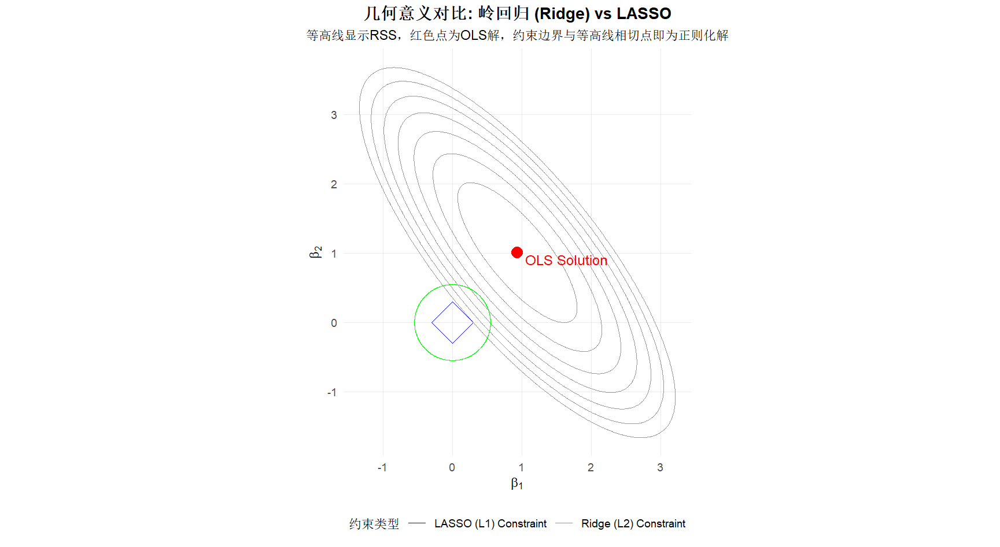
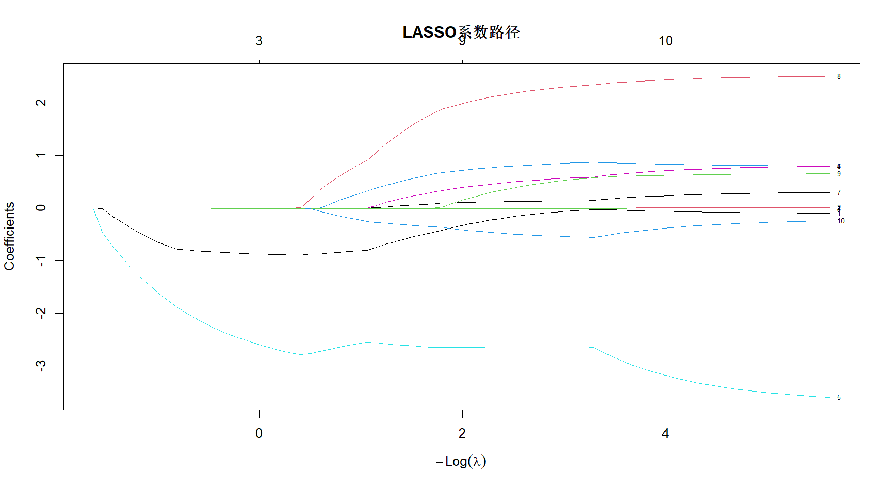
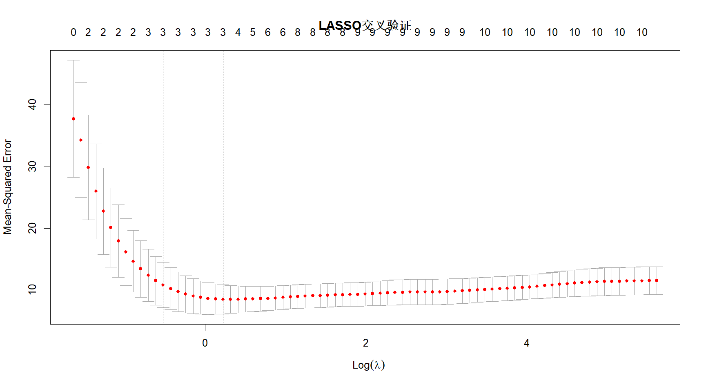
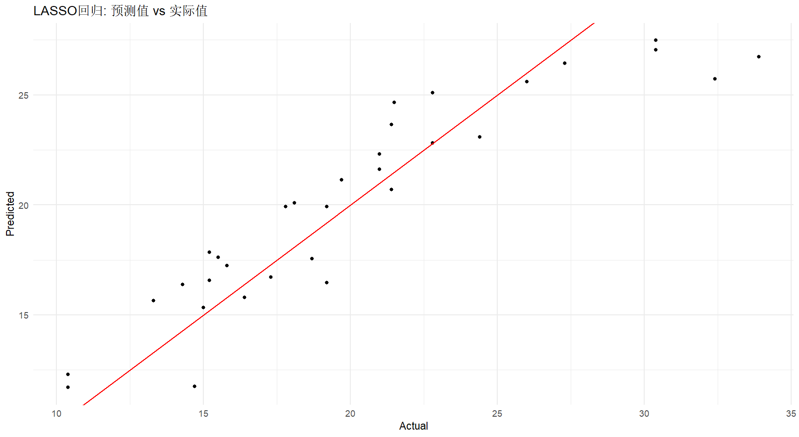
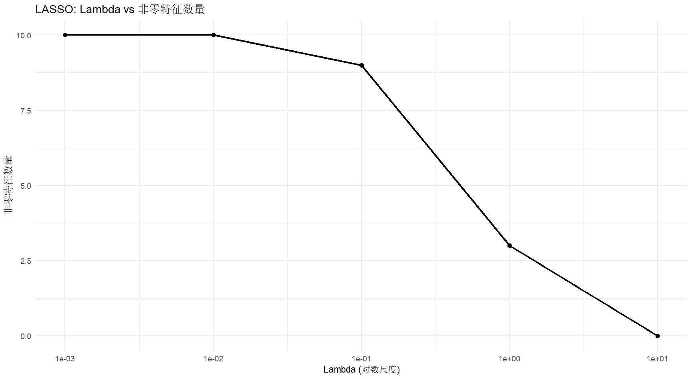

## 多元线性回归

$$y_ = \beta_0 + \beta_1 x_1 + \dots + \beta_n x_m + u$$

回归模型为

$$\hat y = \hat\beta_0 + \hat\beta_1 x_1 + \dots + \hat\beta_m x_m$$

取 $n$ 组观察值，即为

$$
\begin{bmatrix}
y_1 \\ y_2 \\ \vdots \\ y_n
\end{bmatrix} 

=

\begin{bmatrix}
1 & x_{11} & x_{12} & \cdots & x_{1m} \\
1 & x_{21} & x_{22} & \cdots & x_{2m} \\
\vdots & \vdots & \vdots & \ddots & \vdots \\
1 & x_{n1} & x_{n2} & \cdots & x_{nm} \\
\end{bmatrix} 
\begin{bmatrix}
\beta_0 \\ \beta_2 \\ \vdots \\ \beta_m
\end{bmatrix} 
+
\begin{bmatrix}
u_1 \\ u_2 \\ \vdots \\ u_n
\end{bmatrix} 
$$

即

$$\bm{y} =  \bm{X\beta} + \bm{u}$$

其中 $\bm{y}$ 为 $n$ 维响应观察值变量， $\bm{X}$ 为 $n\times m$ 阶解释变量的观察矩阵，$\bm{\beta}$ 为$m$ 阶回归参数向量， $\bm{u}$ 为随机扰动项向量。

回归模型

$$
\hat y = \bm{X\hat\beta} + \bm{e} \\ 
RSS = \sum_{i=1}^n e_i^2 = \sum_{i=1}^n (y_i - \bm{X}_i^{\text{T}}\bm{\hat \beta})^2
$$ 

目标为

$$
\argmin_{\bm{\hat \beta}} RSS
$$

求导

$$
\nabla_{\bm{\beta}} RSS = 0
$$ 

可得

$$
\begin{cases}
  n\hat \beta_0 + \sum \hat \beta_1 x_{i1} + \sum \hat \beta_2 x_{i2} + \cdots + \sum \hat \beta_m x_{m} = \sum y_i \\
  \sum \hat \beta_0 x_{i1} + \sum \hat \beta_1 x_{i1}^2 + \sum \hat \beta_1 x_{i1}x_{i2} + \cdots+ \sum \hat \beta_m x_{i1}x_{im} = \sum x_{i1}y_{i1} \\
  \vdots \\
  \sum \hat \beta_0 x_{im} + \sum \hat \beta_1 x_{i1}x_{im} + \sum \hat \beta_1 x_{im}x_{i2} + \cdots+ \sum \hat \beta_m x_{im}^2 = \sum x_{im}y_{i1}
\end{cases}
$$

这个方程组称为正规方程组

令系数矩阵为 $\bm{A}$ ,常数项向量为 $\bm{B}$

$$
\bm{A} = 
\begin{bmatrix}
  n & \sum x_{i1} & \sum x_{i2} & \cdots & \sum x_{im} \\
  \sum x_{i1} & \sum x_{i1}^2 & \sum x_{i1}x_{i2} & \cdots & \sum x_{i1}x_{im} \\
  \vdots & \vdots & \vdots & \ddots & \vdots \\
  \sum x_{im} & \sum x_{im}x_{i1} & \sum x_{im}x_{i2} & \cdots & \sum x_{im}^2 \\
\end{bmatrix} 

\bm{B} =
\begin{bmatrix}
  \sum y_i \\ \sum x_{i1}y_i \\ \cdots \\ \sum x_{im}y_i   
\end{bmatrix} 
$$

则有

$$\bm{A} = \bm{X}^{\text{T}}X,\bm{B} = \bm{X}^{\text{T}}\bm{y}$$

$\bm{A}$ 可逆时解得 

$$
\bm{\hat \beta} = \bm{A}^{-1}\bm{B} = (\bm{X}^{\text{T}}\bm{X})^{-1}\bm{X}^{\text{T}}\bm{y} \\
\bm{\hat y} = \bm{X} \bm{\hat \beta} = \bm{X}(\bm{X}^{\text{T}}\bm{X})^{-1}\bm{X}^{\text{T}}\bm{y}
$$

记

$$\bm{H} = \bm{X}(\bm{X}^{\text{T}}\bm{X})^{-1}\bm{X}^{\text{T}}$$

称其为帽子矩阵，是一个 $n$ 阶对称矩阵，对角线元素 $h_i$ 给出第 $i$ 个观测值距离其余 $n-1$ 个观测值有多远，称其为杠杆值。

# 线性模型拓展

使用其他方法进行拟合可以得到更好的 **预测准确性 prediction accuracy** 和 **模型解释性 model interpretability**

- **预测准确性** 
  - 当观测个数 $n$ 不能远远大于 $p$ 时，使用最小二乘法容易得到过拟合，方差极大。因此可以考虑以牺牲偏差为代价减小方差，从而提高模型在测试集上的预测准确性。
- **模型解释性**
  - 多元回归模型中，某些预测变量与响应变量并不是线性关系或者无关。此时移除这些变量可以使得模型更有解释能力。通过 **特征选择** 或 **变量选择** 可以实现。
  
三种拟合方法

- **子集选择**
  - 选择预测变量的子集，对子集进行最小二乘法，最后选择表现最优的。
- **压缩估计**
  - 基于全部 $p$ 个预测变量进行模型拟合，通过正则化缩减估计系数，可以压缩至很小（岭回归）或降为零（LASSO，用于变量选择）
- **降维法**
  - 将 $p$ 维预测变量进行线性组合，选取 $M$ 个 （ $M < p$）作为新的预测变量，实现降维，然后执行最小二乘法。

## 压缩估计

### 正向理解

假设预测变量之间不满足线性无关，就有 $|\bm{X}^{\text{T}}\bm{X}| = 0$，于是 $\bm{\beta}$ 无解。倘若预测变量之间近似共线性，方差也会很大导致模型精度降低。我们需要引入惩罚项使回归系数变小，甚至变为0来实现维度压缩。

### 反向理解

参数的维度过多容易造成过拟合，因此我们在考虑最小化RSS的同时，也要考虑维度的影响。

现在考虑我们的目标函数为

$$\argmin_{\bm{\hat \beta}} \left\{ RSS(\bm{\hat \beta}) + g(\dim(\bm{\hat \beta}))\right\}$$

考虑约束

$g(\dim(\bm{\hat \beta})) \leq C$，$C$ 是一个常数

可以构造广义拉格朗日函数

$$L(\bm{\hat \beta},\lambda) =  RSS + \lambda \left[g(\dim(\bm{\hat \beta}))-C\right]$$

其中 $\lambda \geq 0$

理想状态下 $g(\dim(\bm{\hat \beta}))$ 应当是 L0 范数。

$G:C \rightarrow \lambda$ 是一个满射，并且存在单调性。因此通过不断调整 $\lambda$ 可以实现对 $C$ 的控制。

### 岭回归

岭回归的目标为

$$\argmin_{\bm{\hat \beta}} \left\{RSS + \lambda \sum_{i=1}^n \hat\beta_i^2\right\}$$

其中 $\lambda \geq 0$，使用 L2 范数

$$\bm{\hat \beta} = \bm{A}^{-1}\bm{B} = (\bm{X}^{\text{T}}\bm{X}+\lambda\bm{I})^{-1}\bm{X}^{\text{T}}\bm{y} \\$$

### LASSO 

Least Absolute Shrinkage and Selection Operator最小绝对收缩和选择算子

LASSO的目标为

$$\argmin_{\bm{\hat \beta}} \left\{RSS + \lambda \sum_{i=1}^n |\hat\beta_i|\right\}$$


其中 $\lambda \geq 0$，使用 L1 范数，可以产生更多的稀疏解。从而有压缩维度的效果。



# Code

## R

```r
if (!require(glmnet)) install.packages("glmnet");library(glmnet)
if (!require(ggplot2)) install.packages("ggplot2");library(ggplot2)
if (!require(dplyr)) install.packages("dplyr");library(dplyr)

data(mtcars)


x <- as.matrix(mtcars[, -1])  # 特征矩阵
y <- mtcars$mpg               # 响应变量

colnames(x)

set.seed(123)
lasso_model <- glmnet(x, y, alpha = 1)
print(lasso_model)

plot(lasso_model, xvar = "lambda", label = TRUE)
title("LASSO系数路径")
```

```r
#交叉验证
set.seed(123)
cv_lasso <- cv.glmnet(x, y, alpha = 1)
plot(cv_lasso)
title("LASSO交叉验证")

# 查看最优lambda值
lambda_min <- cv_lasso$lambda.min
lambda_1se <- cv_lasso$lambda.1se

cat("最小MSE对应的lambda:", lambda_min, "\n")
cat("1个标准差规则对应的lambda:", lambda_1se, "\n")
coef_min <- coef(cv_lasso, s = "lambda.min")
cat("最小lambda对应的系数:\n")
print(coef_min)
coef_1se <- coef(cv_lasso, s = "lambda.1se")
cat("1se lambda对应的系数（更稀疏）:\n")
print(coef_1se)

coef_comparison <- data.frame(
  Feature = rownames(coef_min),
  Coef_min = as.numeric(coef_min),
  Coef_1se = as.numeric(coef_1se)
)
print(coef_comparison)
```





```r
# 使用最优lambda进行预测
predictions <- predict(cv_lasso, newx = x, s = "lambda.min")
rmse <- sqrt(mean((y - predictions)^2))
cat("LASSO模型RMSE:", rmse, "\n")
r_squared <- 1 - sum((y - predictions)^2) / sum((y - mean(y))^2)
cat("LASSO模型R²:", r_squared, "\n")
plot_data <- data.frame(Actual = y, Predicted = as.numeric(predictions))
ggplot(plot_data, aes(x = Actual, y = Predicted)) +
  geom_point() +
  geom_abline(intercept = 0, slope = 1, color = "red") +
  ggtitle("LASSO回归: 预测值 vs 实际值") +
  theme_minimal()

# 拟合普通线性回归模型
lm_model <- lm(mpg ~ ., data = mtcars)
lm_predictions <- predict(lm_model)
lm_rmse <- sqrt(mean((y - lm_predictions)^2))
lm_r_squared <- summary(lm_model)$r.squared

# 比较结果
comparison <- data.frame(
  Model = c("普通线性回归", "LASSO回归"),
  RMSE = c(lm_rmse, rmse),
  R_squared = c(lm_r_squared, r_squared),
  Num_features = c(length(coef(lm_model)) - 1, 
                   sum(coef_min[-1] != 0))  # 非零特征数
)
print(comparison)

zero_coef_features <- coef_comparison$Feature[coef_comparison$Coef_1se == 0]
cat("被LASSO剔除的特征（lambda.1se）:\n")
print(zero_coef_features)
```

这里LASSO将原来的10个特征压缩到了3个


```r
# 测试不同的lambda值
lambda_values <- c(0.001, 0.01, 0.1, 1, 10)

# 存储结果
results <- data.frame()

for (lambda in lambda_values) {
  # 使用指定lambda拟合模型
  model <- glmnet(x, y, alpha = 1, lambda = lambda)
  coefs <- as.numeric(coef(model))
  non_zero <- sum(coefs[-1] != 0)
  preds <- predict(model, newx = x)
  rmse_val <- sqrt(mean((y - preds)^2))
  results <- rbind(results, data.frame(
    Lambda = lambda,
    NonZero_Coefficients = non_zero,
    RMSE = rmse_val
  ))
}

print("不同lambda值的效果:")
print(results)

ggplot(results, aes(x = Lambda, y = NonZero_Coefficients)) +
  geom_line(size = 1) +
  geom_point(size = 2) +
  scale_x_log10() +
  labs(title = "LASSO: Lambda vs 非零特征数量",
       x = "Lambda (对数尺度)", y = "非零特征数量") +
  theme_minimal()
```
```
 Lambda NonZero_Coefficients     RMSE
1  1e-03                   10 2.146968
2  1e-02                   10 2.149151
3  1e-01                    9 2.189225
4  1e+00                    3 2.593994
5  1e+01                    0 5.932030
```

